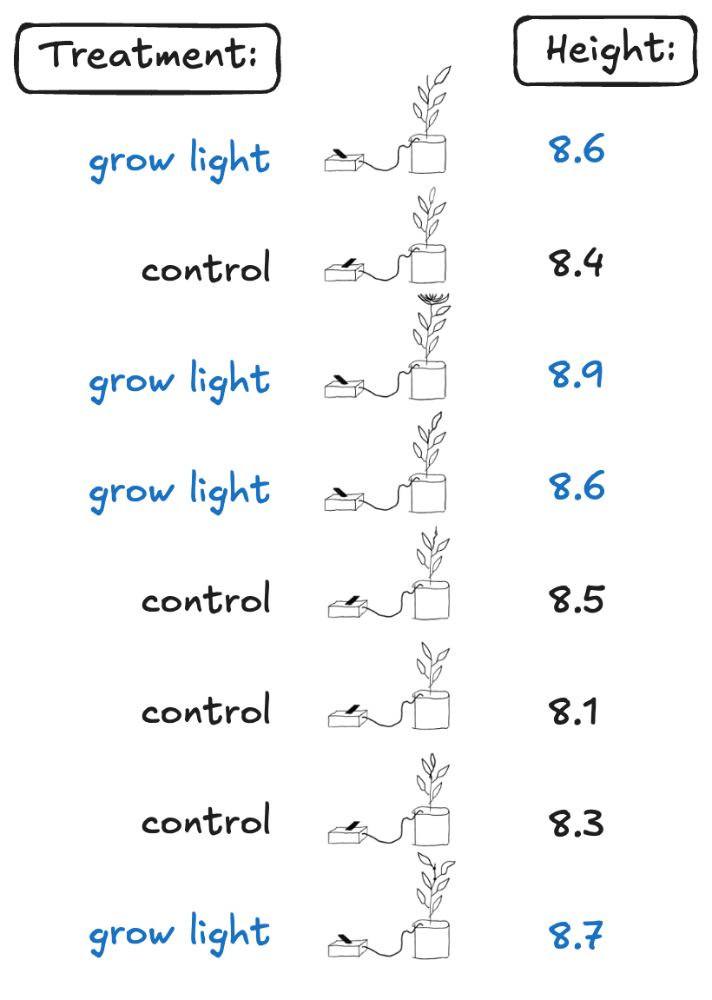

```{r}

library(tidyverse)
```


# Introduction to Causal Inference and Randomization-Based Inference


## Example Experiment

**Question:** Do grow lights affect the growth of plants?

  - Grow 8 plants from seed ($N = 8$)
  - CRD
  - Treatment: expose a plant to a grow light for 2 hours each day.
      - Factor: whether exposed to grow light
  - Measure height of plants after 1 month

**Direct Controls:**


## Data


{width=30%}

## Exact p-value based on randomization


:::columns

:::column
- $H_0$: There is no effect of the treatment on the plant height 

</br>

- What is the chance that the **four highest plants** ended up being the ones that got the treatment?

$$\frac{1}{\binom{8}{4}} = \frac{1}{70}$$
:::

:::column
{width=60%}

:::

:::


## What went into the p-value?

:::columns

:::column

- No model for how the data was generated
- The **treatment** is random, not the data!
- **Makes essentially no statistical assumptions except for random assignment**
:::

:::column
{width=60%}

:::

:::

## Choosing a test statistic

- You can technically use anything you want!
- In some cases, the test statistic will matter for power
- This analysis should be chosen in advance!

## Test statistic -- difference in means

```{r}
ctl = c(8.4, 8.5, 8.1, 8.3)
trt = c(8.6, 8.9, 8.6, 8.7)

data <- tidyr::tibble(treatment = c(1,1,1,1,0,0,0,0),
                      height = c(trt, ctl))

```

```{r}

obs_dif <- mean(trt) - mean(ctl)


trtids <- combn(8, 4) |> 
  data.frame()

dif_means_it <- function(ids, outvec){
  
  trt <- outvec[ids]
  ctr <- outvec[-ids]
  
  mean(trt) - mean(ctr)
  
}

perm_means <- map_dbl(trtids, ~dif_means_it(.x, outvec = data$height)) |> 
  enframe() |> 
  mutate(pval = abs(value) >= abs(obs_dif))

perm_means |> 
  ggplot() + 
  geom_histogram(aes(x = value,
                     fill = pval)) +
  #geom_vline(xintercept = obs_dif, color = "red") +
  scale_fill_manual(values = c("black", "red"), guide = "none") +
  labs(x = "Randomized Difference in Means",
       y = "Number of Randomizations")


```


## Test statistic -- difference in medians

```{r}

obs_dif <- median(trt) - median(ctl)

dif_medians_it <- function(ids, outvec){
  
  trt <- outvec[ids]
  ctr <- outvec[-ids]
  
  median(trt) - median(ctr)
  
}

perm_medians<- map_dbl(trtids, ~dif_medians_it(.x, outvec = data$height)) |> 
  enframe() |> 
  mutate(pval = abs(value) >= abs(obs_dif))

perm_medians |> 
  ggplot() + 
  geom_histogram(aes(x = value,
                     fill = pval)) +
  #geom_vline(xintercept = obs_dif, color = "red") +
  scale_fill_manual(values = c("black", "red"), guide = "none") +
  labs(x = "Randomized Difference in Medians",
       y = "Number of Randomizations")


```


## But what is the magnitude of the effect?

- So far, we have just tested for evidence of an effect or not (just considering our null vs. alternative hypotheses)

- How can we use randomization inference to calculate the treatment effect? A confidence interval for the point estimate?

## Treatment Effect Model

- Suppose the effect of the grow lamp is to increase the height of the plant by an amount $\tau$?
  - e.g. Plant 1 was assigned treatment and had a height of 8.6"
  - This model assumes that if Plant 1 was assigned control, the observed height would have been 8.6 - $\tau$
- Given the data, what are **plausible values** of $\tau$?

:::callout-tip
## Plausible Values

If we would *not* reject the null hypothesis of $H_0: \tau = \tau_0$ at a significance level of $\alpha$, then $\tau_0$ is a *plausible value* for $\tau$.

The set of all plausible values makes up a (1-$\alpha$)*100% confidence interval.
:::


## Testing Plausible Values

:::columns

:::{.column width=60%}


- We already found that $\tau_0 = 0$ is **not** a plausible value for $\tau$ based on the data.

- Let's test $H_0: \tau = .2$ vs. $H_A: \tau \neq .2$ next.


1. Calculate the plant heights under control assuming $\tau = 0.2$ $\rightarrow$ $\tilde{y}_{i}$
2. Get a p-value using randomization inference like before, but with the adjusted outcomes $\tilde{y}_{i}$

:::

:::{.column width=40%}


| Treatment | $y_{i}$ | $\tilde{y}_{i}$ |
|-----------|-----------------|----------------------------------------|
| treat         | 8.6             |                       |
| control        | 8.4             |                                     |
| treat        | 8.9             |                         |
| treat         | 8.6             |                        |
| control       | 8.5             |                                     |
| control         | 8.1             |                                     |
| control        | 8.3             |                                    |
| treat         | 8.7             |                     |
:::

:::

## Point Estimate and Confidence Interval

```{r}


test_tau <- function(tau0, dat){

  null_dat <- dat |> 
    mutate(ytilde = height - treatment*tau0)
  
  obs_dif = mean(null_dat$ytilde[null_dat$treatment == 1]) -
    mean(null_dat$ytilde[null_dat$treatment == 0])
  
  map_dbl(trtids, ~dif_means_it(.x, outvec = null_dat$ytilde)) |> 
    enframe() |> 
    summarize(pval = mean(abs(value) >= abs(obs_dif))) |> 
    pull(pval)
}

hodges <- map_dbl(seq(0, 1, by = .01), 
        .f = ~test_tau(tau0 = .x, dat = data)) |> 
  enframe() |> 
  mutate(tau = seq(0, 1, by = .01)) 


hodges |> 
  ggplot(aes(x = tau, y = value)) + 
  geom_point() +
  geom_hline(yintercept = .05, linetype = "dotted",
             color = "blue") +
  labs(x = "", y = "")

```


# Potential Outcomes Framework and Estimation

## Counterfactuals

**Setup:** 

- We have an experiment with $N$ subjects
- One-way treatment wtih just one treatment group and one grontrol group
- $n_t$ subjects assigned to treatment and $n_c$ to control

**Big Idea**

- For each subject, we only see the outcome given the treatment that subject was assigned
- There is always a "counterfactual" outcome, if they had the other treatment


## Potential Outomes

- For each subject $i$ there are two potential outcomes, $y_i^t$ and $y_i^c$
- These potential outcomes are **fixed**
- We only observe one:

$$
Y_i =
  \begin{cases}
    y_i^t       & \quad \text{if subject } i \text{ is assigned to treatment}\\
    y_i^c       & \quad \text{if subject } i \text{ is assigned to control}
  \end{cases}
$$

## Design-Based Causal Inference


- Conducts inference *solely* based on the randomness of the treatment assignment


**Assumptions**:

- Stable Unit Treatment Value Assumption (SUTVA): one subject's treatment status does not affect another subject's outcome
- Potential outcomes are "not affected by how or whether we try to learn about [them]" - Rubin, 2005

## A bit more notation

Define the random treatment assignment variable as
$$
T_i =
  \begin{cases}
    1      & \quad \text{if subject } i \text{ is assigned to treatment}\\
    0      & \quad \text{if subject } i \text{ is assigned to control}
  \end{cases}
$$
Then we can write the **observed** outcome as:

$$Y_i = T_iy_i^t + (1-T_i)y_i^c$$


## Plant Example -- Observed

| Plant |  $T_i$ | $y_i^t$ | $y_i^c$ |
|-------|--------|---------|---------|
| 1     | 1      | 8.6     |         |
| 2     | 0      |         | 8.4     |
| 3     | 1      | 8.9     |         |
| 4     | 1      | 8.6     |         |
| 5     | 0      |         | 8.5     |
| 6     | 0      |         | 8.1     |
| 7     | 0      |         | 8.3     |
| 8     | 1      | 8.7     |         |


## Plant Example -- Counterfactuals

| Plant |  $T_i$ | $y_i^t$ | $y_i^c$ |
|-------|--------|---------|---------|
| 1     | 1      | 8.6     | [8.3]{style="color: #d3d3d3;"}       |
| 2     | 0      | [9.1]{style="color: #d3d3d3;"}       | 8.4     |
| 3     | 1      | 8.9     | [8.5]{style="color: #d3d3d3;"}       |
| 4     | 1      | 8.6     | [8.6]{style="color: #d3d3d3;"}       |
| 5     | 0      | [8.8]{style="color: #d3d3d3;"}       | 8.5     |
| 6     | 0      | [8.7]{style="color: #d3d3d3;"}       | 8.1     |
| 7     | 0      | [8.7]{style="color: #d3d3d3;"}       | 8.3     |
| 8     | 1      | 8.7     | [8.5]{style="color: #d3d3d3;"}       |

## Treatment Effects

:::columns

:::column
- Define the **individual treatment effect** as $\tau_i = y_i^t - y_i^c$
- The individual treatment effect is **never observed**
- We don't have to assume that the treatment effect is the same for all units!
:::

:::column
| Plant | $y_i^t$ | $y_i^c$ |  $\tau_i$ | $T_i$ | $Y_i$ |
|-------|---------|---------|-----|-----|-------|
| 1     | 8.6     | 8.3     |     | 1   |       |
| 2     | 9.1     | 8.4     |     | 0   |       |
| 3     | 8.9     | 8.5     |     | 1   |       |
| 4     | 8.6     | 8.6     |     | 1   |       |
| 5     | 8.8     | 8.5     |     | 0   |       |
| 6     | 8.7     | 8.1     |     | 0   |       |
| 7     | 8.6     | 8.3     |     | 0   |       |
| 8     | 8.7     | 8.5     |     | 1   |       |
:::
:::

## Average Treatment Effect (ATE)

- Individual treatment effects are not observed... and cannot be estimated without more information!
- Define the average treatment effect (ATE) as

$$\bar{\tau} = \frac{1}{N} \sum_{i=1}^N \tau_i$$

- $\bar{\tau}$ is not observed, but it **can** be estimated!
- We call $\bar{\tau}$ our **causal estimand**

## Estimating the ATE

Note we could consider:

:::columns
:::column

\begin{align}
\bar{\tau} &= \frac{1}{N} \sum_{i=1}^N \tau_i \\
           &= \frac{1}{N} \sum_{i=1}^N y_i^t - y_i^c \\
           &= \frac{1}{N} \sum_{i=1}^N  y_i^t - \frac{1}{N} \sum_{i=1}^N y_i^c \\
           &= \bar{y}^t - \bar{y}^c
\end{align}
:::

:::column
- We can estimate $\bar{y}^t$ and $\bar{y}^c$
- A simple random sampling problem!

:::
:::


## Estimating the ATE - Difference in Means

Let $\mathcal{T}$ be the indices of the units defined treatment and $\mathcal{C}$, those assigned control. 

We can formally write the **difference in means** estimator as:

$$\hat{\tau} = \frac{1}{n_t}\sum_{i \in \mathcal{T}} Y_i - \frac{1}{n_c}\sum_{i \in \mathcal{C}} Y_i$$

:::callout-tip
# Unbiased Estimator for the ATE

Just assuming 

1. the treatment **was** randomly assigned
2. the potential outcomes framework, and
3. SUTVA

$\hat{\tau}$ is an **unbiased estimator** of $\bar{\tau}$
:::

## Design-Based Inference model vs. ANOVA model

**Design-Based Inference:**

$$Y_i = T_iy_i^t + (1-T_i)y_i^c$$

$$y_i^t = y_i^c + \tau_i$$

**ANOVA:**

$$Y_i = \mu +  \bar{\tau}T_i + \epsilon_{i} \text{, where } \epsilon_{i} \overset{iid}{\sim} N(0, \sigma^2)$$
