```{r}

library(tidyverse)
```

# Types of Observational Studies

## Observational Studies in Medicine

- An observational study is only defined by the fact that the researcher did not manipulate a treatment

> Observational research involves systematically observing and recording subjects, events, or phenomena without directly manipulating the variables under study.
Source: International Network for Natural Sciences

- Observational studies may be descriptive or "analytical"
- Many different kinds!

## Typical Types Observational Studies in Medicine

](_images/092-Classification-of-observational-studies.ppm)

## Types Observational Studies


- **Cohort study**: The researchers identify individuals according to the explanatory variable and then observe the outcomes of the response variable.
- **Case-control study**: The researchers identify observational units in each response variable category (the “cases” and the “controls”) and then determine the explanatory variable outcome for each observational unit.
- **Cross-sectional study**: The researchers get a cohort at a specific point in time categorize subjects according to both the explanatory and the response variable simultaneously.
- **Case-reports**: detailed report of the symptoms, signs, diagnosis, treatment, and follow-up of an individual patient. 

Sources: [ISCAM](http://www.rossmanchance.com/iscam4/) and [NIH](https://pmc.ncbi.nlm.nih.gov/articles/PMC5686928/)

## Typical Types Observational Studies in Medicine


## More Types of Observational Studies

- **Surveys**: Getting information from people based on their responses to questions.

- **Ecological surveys**: Systematic study of an environment.

- **Longitudinal studies**: Follow individuals over a long period of time, collecting information about them periodically.

- **Quasi-experimental / natural experiments**: An intervention was not manipulated by the researcher, but could reasonably be considered to have been randomly applied by nature.


# Administrative Data


:::callout-note
# Head's up

We are going to talk about some historic documents and surveys which contain violent language towards various groups.
:::

## What is Administrative Data?

> Administrative data refers to data collected and maintained by federal, state, and local governments, as well as some commercial entities.  This information is called “administrative data” because data collected and maintained by agencies or firms are used to administer (or run) programs and provide services to the public.


- [US Census](https://www.census.gov/topics/research/guidance/restricted-use-microdata/administrative-data.html)


## Major Sources of US Data

](_images/092-stat-agencies.png){width=60%}


## Major Sources of US Data

See also:

- [Budget Document for Official Statistics](https://www.govinfo.gov/content/pkg/BUDGET-2025-PER/pdf/BUDGET-2025-PER-3-7.pdf)
- [American Economic Association](https://www.aeaweb.org/about-aea/committees/economic-statistics/agencies)
- [Wikipedia does a good job too](https://en.wikipedia.org/wiki/Federal_statistical_system)

## American Community Survey (ACS)

> Covering more than 40 topics—including education, employment, income, housing, and transportation—the ACS provides crucial insights into the changing needs and conditions of communities.

- Conducted every **month** since 2005

- Like the census, response is required by law

- **How:** Physical survey mailed to houses, but can be completed on paper or online

- **Sampling:** Take a (complex) random sample of **addresses**


- [Learn more about the sampling methodology](https://www.census.gov/programs-surveys/acs/methodology/design-and-methodology.html)

- [Learn more about the ACS vs.  Census](https://www.census.gov/programs-surveys/acs/about/acs-and-census.html)

## American Community Survey - questionnaire

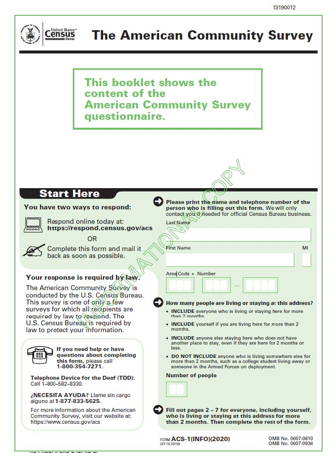{width=40%}

## American Community Survey - demographics
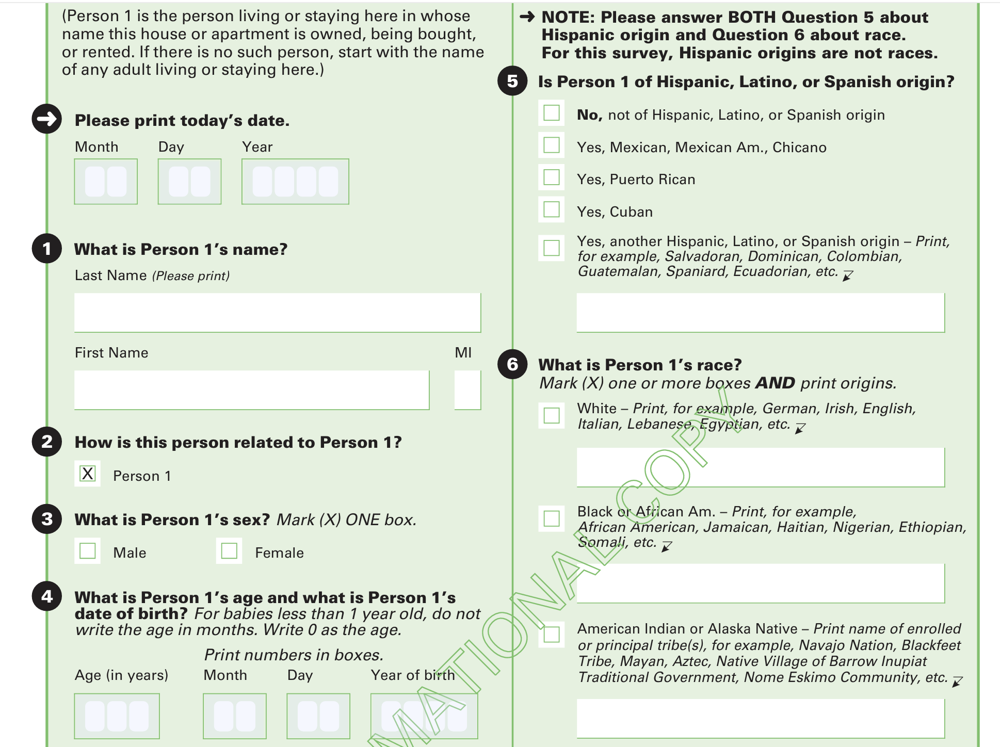{width=70%}

## American Community Survey - race and ethnicity

:::columns

:::column

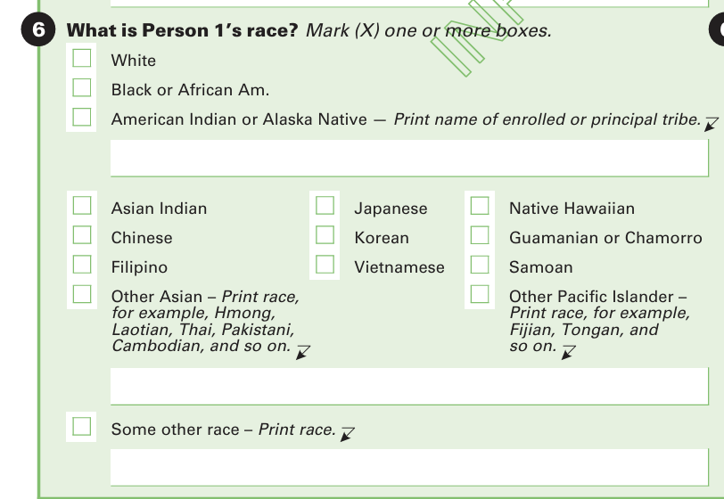
:::
:::column

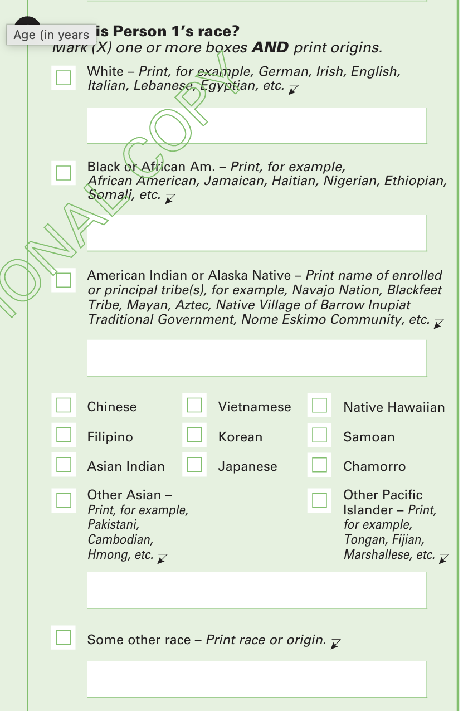{width=70%}

:::

:::

## American Community Survey

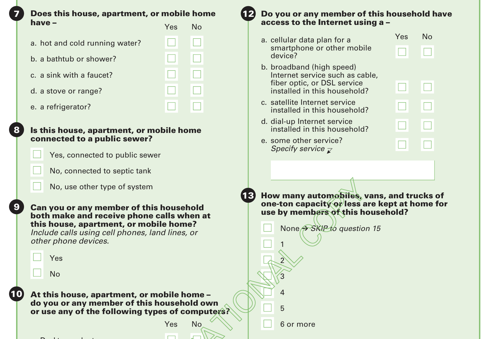{width=70%}

## Behavioral Risk Factor Surveillance System (BRFSS)

> The Behavioral Risk Factor Surveillance System (BRFSS) is the nation’s premier system of health-related telephone surveys that collect state data about U.S. residents regarding their health-related risk behaviors, chronic health conditions, and use of preventive services.

Source: [CDC](https://www.cdc.gov/brfss/about/brfss_faq.htm)

- **How** Telephone interviews 
  + methodology had to change in 2011 
- **Sampling**: random digit dialing


## BRFSS Questionnaire 2024


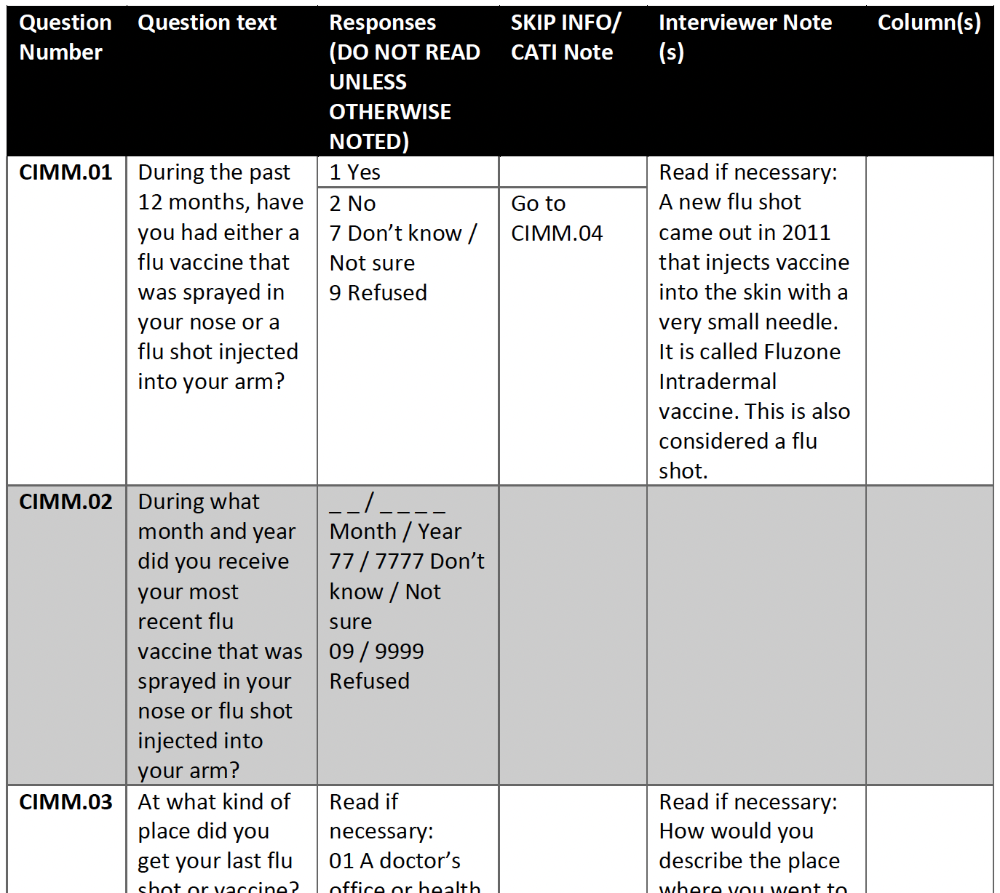{width=50%}


## BRFSS Questionnaire 1984

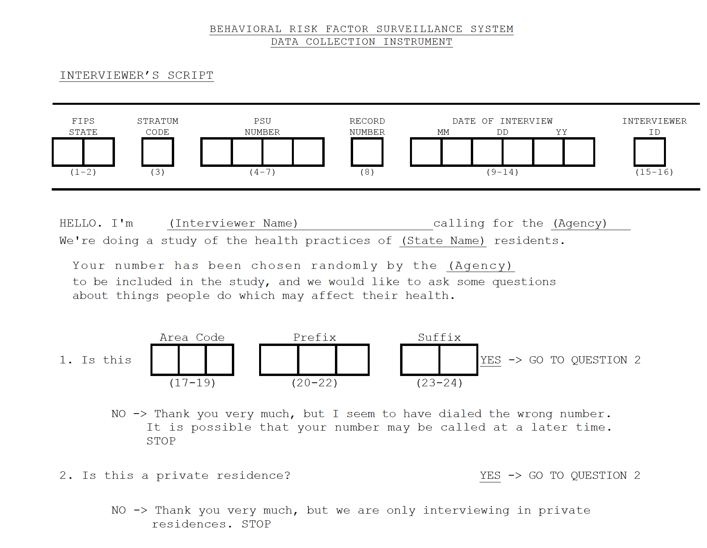{width=70%}

## BRFSS Questionnaire 1984


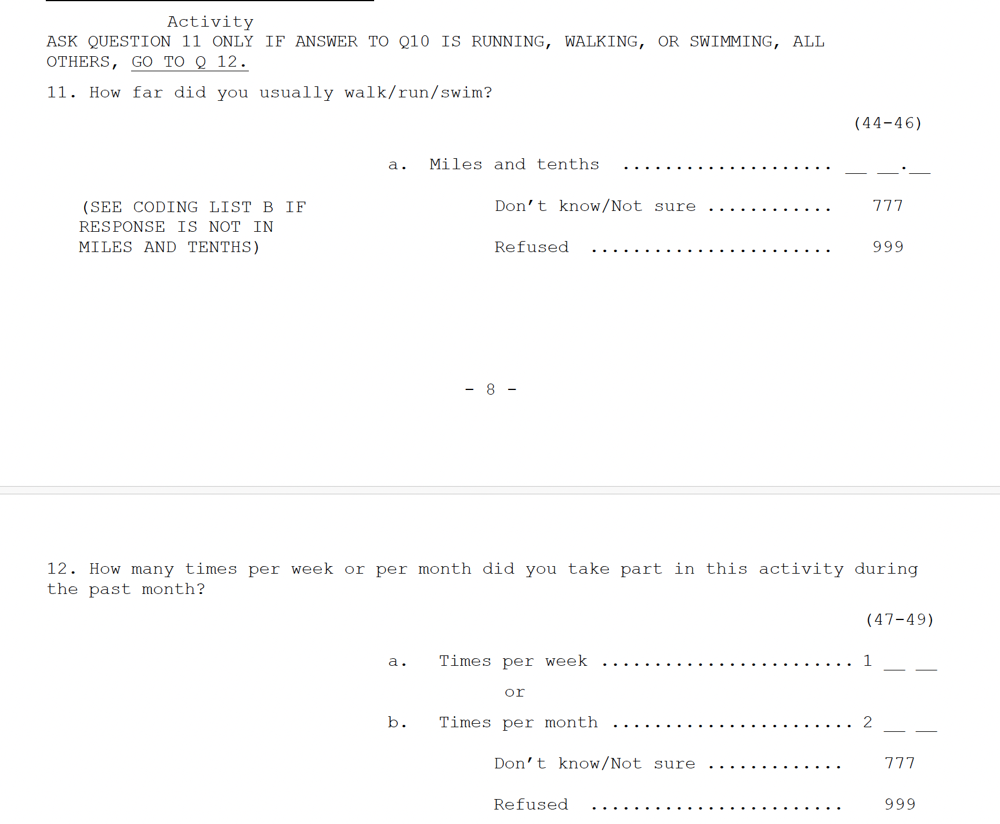{width=70%}

## BRFSS Data Tool

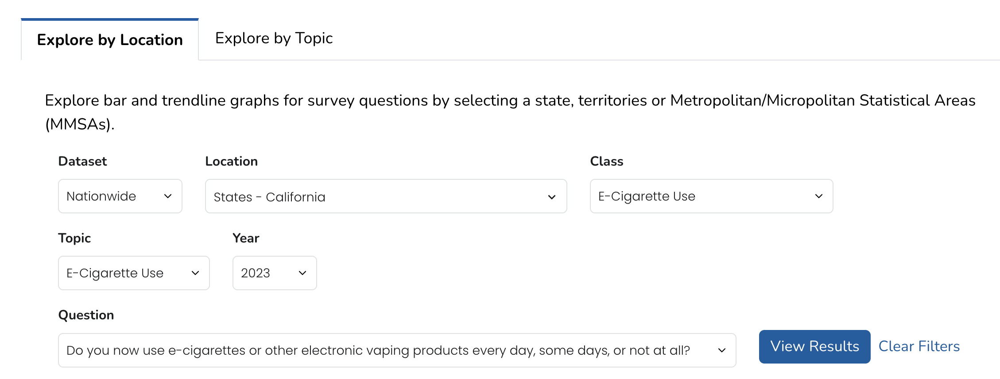


## US Census

- US Census Bureau conducts a full US census every 10 years
- What year did the US Census start?
- Why did they start it?


## First US Census 

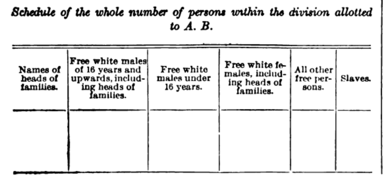{width=45%}
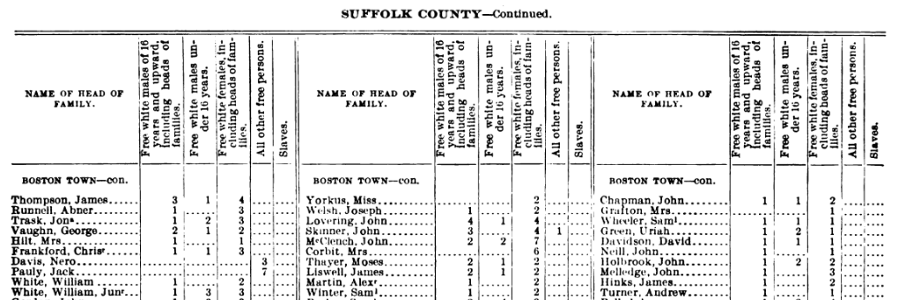


## How is Census Information Used?


## Census as a Method

- Every element within a population is surveyed

- Expensive -- 2020 census cost $96 per household

- Possibilities for errors?
  - Sampling error
  
  - Nonresponse error
  
  
  - Nonsampling errors
  
  
  

## US Census Accuracy

- Possible issues:
  - people being missed! (not counted)
  - people being counted more than once (or included inappropriately).
- Net undercount:
\# people missed > \# people counted more than once
- Net overcount:
\# people counted more than once > \#people missed

## US Census Accuracy - 2020

](https://www.census.gov/content/dam/Census/library/stories/2022/03/who-was-undercounted-overcounted-in-2020-census-table-2.jpg)


## Census vs. Sampling


:::columns

:::column
- Census: Every element within a population is surveyed to learn about a characteristic
- Sampling: A subset of elements in a population are surveyed to  estimate the distribution of a characteristic in a population
:::

:::column

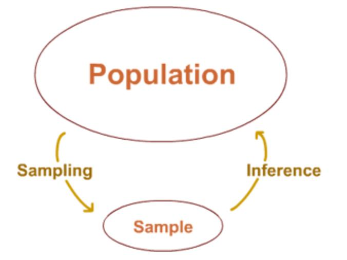
:::
:::


## Census vs. Sampling - why?

Why use sampling?:

1. Can provide reliable information at far less cost than a census

2. Data can be collected and published faster

3. Survey estimates are often more accurate


## Census vs. Sampling - why?

- Census:
  - requres large administrative organization and lots of people to work on collecting data
  - many types of errors can happen in different phases of the process
  
- Sampling:
  - More time to better train personnel and follow-up with nonrespondents to ensure data quality

::: callout-tip
## Big idea

Better to have good data on a representative sample than unreliable or biased measurements on the whole population.
:::

## Food for Thought about Administrative Data

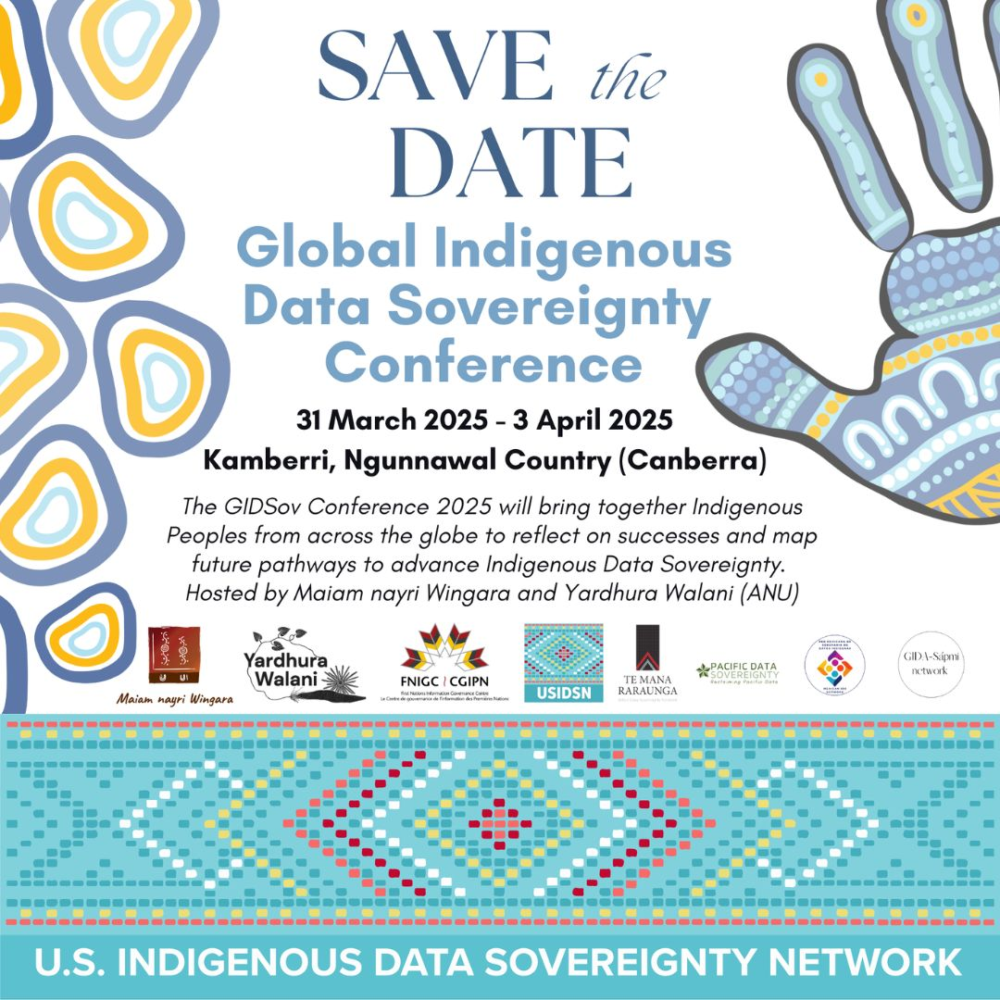{width=50%}

