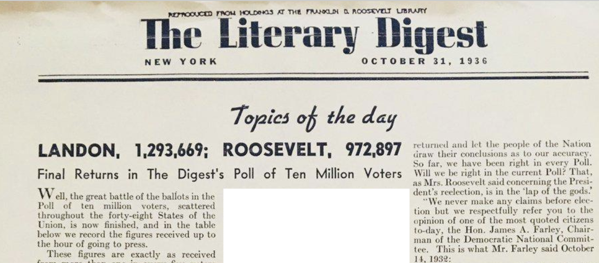
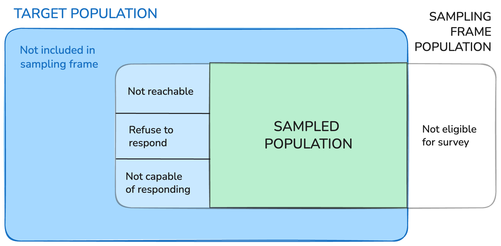
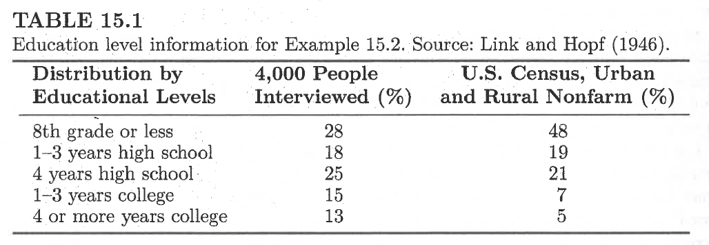
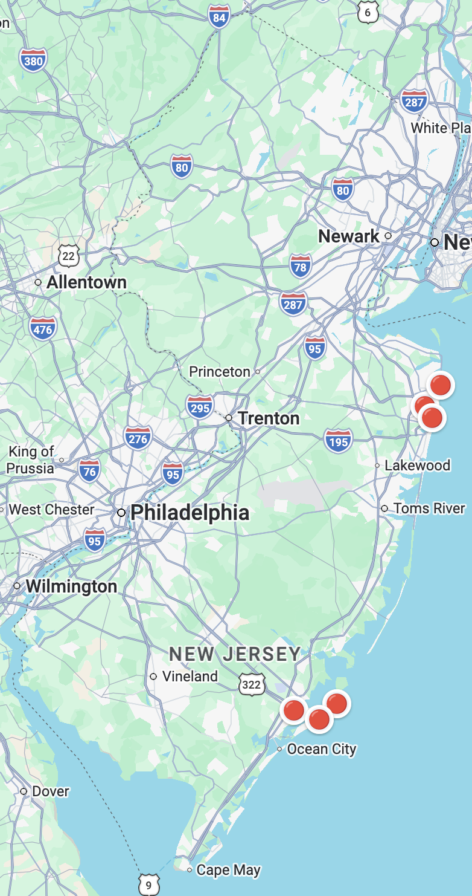

```{r}
#| echo: false

library(tidyverse)
```


# Survey Sampling Terminology

:::callout-note
Lecture based on *Sampling Design and Analysis 3rd Edition* by Sharon L. Lohr Chapters 1, 2, and 15. Figures are from this text or recreated based on figures from the text unless otherwise noted!
:::

## Example: Literary Digest Poll (Activity 9.1)

The Literary Digest boasted that they polled **10 million** voters across the 48 states in the US in October 1936. For each voter polled, they sent out a "straw ballot" and asked that it be mailed back once completed. Out of the **2.3 million ballots returned**, 1,293,699 said they planned to vote for for Landon, and 972,897 for Roosevelt. The list of 10 million voters primarily came from car registration lists and telephone books. (Source: [Squire, 1988](https://www.jstor.org/stable/2749114))

{width=40%}

## Building Blocks

- **Observational unit:** (or **element** or **measurement unit**): object on which a measurement is taken


- **Target population:** complete collection of observations we want to study ($N$)


- **Sample** subset of a population  ($n$)


## Sampling Terminology 

- **Sampling unit:** The unit **actually sampled**
  - Non-overlapping collections fo elements from the population that cover the entire population.

  - When might observational units and sampling units be different?


</br>


- **Sampling frame:** A list of sampling units from which a sample may be selected.

  - Rare to have a sampling frame with every element of the population!


## Sampling Terminology 

- **Sampled population** the collection of all possible observational units that *might have* been chosen in a sample; the population from which the sample was *actually* taken.

- **Sample** (refining this): collection of sampling units drawn from the sampling frame(s)


## Putting it All Together

{width=90%}


# Types of Sampling

## Probability Sampling

- Each unit in the population has a known probability of selection
  - Relatedly, each possible **sample** from the population has a known probability of selection
  - The probabilities of all possible **samples** sum to 1.
- Randomization mechanism used to choose units
- Able to assess the variability (therefore precision) of statistics calculated from the sample
- Avoid sampling bias


## Non-probability Sampling

- Does not involve any form of random select
- Representative??
- Examples:
  - Convenience sampling
  - Quota sampling
  - Judgement sampling

  
## Convenience sampling

- Primary consideration for selecting the sample is how easy it is to recruit the units

- Examples:

:::columns
:::{.column width=20%}
{fig-alt="pepsi logo on a bottle cap"}


:::
:::{.column width=80%}
:::
:::


  


## Quota Sampling

- Population is divided into different sub-populations and specified numbers (quotas) of units are required in each sub-population
- Example:
  - Population: 23% first years, 23% 2nd, 23% 3rd, 23% 4th, 8% other years
  - Sample size: 200
  - continue sampling until you get the required \% in each group and then you stop.

## Quota Sampling Example 
- Link, H. C., & Hopf, H. A. (1946). *People and books; a study of reading and book-buying habits.* Book Manufacturers Institute.

- Quota factors: area, city size, age, sex, and socioeconomic status
- Psychologist determined the blocks of the city
- Interview people from a specified socioeconomic group.
- Interviewers were allowed to choose the specific households.
- n = 4,000

## Quota Sampling Example 

- Found... 31% of “active readers” had bought the last book they read \&
- ... 25% of all last books read cost $1 or less.
- But ...
{width=60%}

... oversampled more educated readers

## Judgement Sampling

- The people conducting the survey use "judgement'' to decide which population units are included in the sample

</br>

- Example: [Rivera (2016)](https://rucore.libraries.rutgers.edu/rutgers-lib/49079/)
  - investigating residents' experiences with applying for and obtaining federal disaster aid

## Judgement Sampling -- Example Hurricane Sandy 

:::columns
:::{.column width=80%}
- judgement sample of six New Jersey municipalities 

>These cities were chosen because they are located on the coast, and they all experienced similar disaster affects, such as damages due to flooding, storm surge, and windshear.  [Rivera (2016)](https://rucore.libraries.rutgers.edu/rutgers-lib/49079/)

- then random digit dialing used to get a random sample *within* each
:::
:::{.column width=20%}

:::
:::


## Probability Sampling Examples


- simple random sampling
- systematic sampling
- stratified sampling
- cluster sampling
- ...


# Simple Random Sampling

## Reminder: Probability Sampling

- Each element in the population has a known probability of selection
  - To be representative, this probability needs to be greater than 0
- So... each possible **sample** from the population has a known probability of selection
- The probabilities of each sample being drawn add to 1 (one)

## Framework for Probability Sampling

- Consider the finite population of $N = 4$ units: $\{1, 2, 3, 4\}$

- Possible samples of $n=2$?


</br>


- There are $\binom{N}{n} = \frac{N!}{n!(N-n)!}$ possible samples of size $n$ that can be drawn with out replacement from a population of size $N$


## Framework for Probability Sampling

- Each possible sample $\mathcal{S}$ has a known probability of being chosen $P(\mathcal{S})$

- The differences in how we assign these probabilities is what distinguishes different probability sampling designs!

Example samples: $\mathcal{S}_1 = \{1,2\}, \mathcal{S}_2 = \{1,3\}, \mathcal{S}_3 = \{1,4\}, \mathcal{S}_4 = \{2,3\}, \mathcal{S}_5 = \{2,4\}, \mathcal{S}_6 = \{3,4\}$

## Inclusion Probability

- What is the probability of each individual unit being sampled?
$$\pi_i = P(\text{unit } i \text{ in the sample})$$
- $\pi_i$: sum the probabilities of all possible samples that include unit $i$

Example samples: $\mathcal{S}_1 = \{1,2\}, \mathcal{S}_2 = \{1,3\}, \mathcal{S}_3 = \{1,4\}, \mathcal{S}_4 = \{2,3\}, \mathcal{S}_5 = \{2,4\}, \mathcal{S}_6 = \{3,4\}$


## Simple Random Sample Without Replacement (SRS)

- Simplest (pun not(?) intended) probability sample
- **SRS:** Every possible subset of $n$ units from the population of $N$ units has an **equal probability** of being sampled.


$$P(\mathcal{S}) = \frac{1}{\binom{N}{n}}$$
$\pi_i = \frac{\text{total number of samples that contain unit } i}{\text{total number of samples of size } n}$

## Simple Random Sample in R

:::columns

:::column
With a dataset:

```{r}
nrow(airquality)

sample_air <- airquality |> 
  slice_sample(n = 20, replace = F)
```

```{r}
#| echo: true
#| eval: false

sample_air
```

```{r}
#| echo: false
#| eval: true

sample_air |> 
  knitr::kable() |> 
  kableExtra::scroll_box(height = "150px") |> 
  kableExtra::kable_styling(font_size = 20)
```
:::
:::column

With a vector:

```{r}
ids_vec <- 1:100

sample_ids <- sample(ids_vec, 
                     size = 20,
                     replace = F)
sample_ids
```

:::
:::

# Goals of Survey Sampling and Types of Errors

## Why are we doing all of this!?

- Want to learn about the world!
- **Estimate** something about our **population**
- We want to these estimates to be as "accurate" as possible

## What can go wrong?

- **Errors of non-observation**: sampled elements do not make up the entire population.
  - Sampling
  - Coverage (selection-bias)
  - Non-response
  
- **Errors of observation**: recorded data deviate from the truth
  - Interviewer
  - Respondents
  - Instrument
  - Method of data collection and analysis
  
## Sampling Error

- If you do not take a census, then sampling error will be present
- Probability samples control and estimate sampling error
- Can be reduced with good sampling design and appropriate sample size

## Coverage Error

- Sampled population does not match the target population (selection bias)
{width=60%}
- Communicate coverage errors and explain how the sampled population differs from the target population
  
## Coverage Error

- **undercoverage**: sampling frame does not include every element of the population 

- **overcoverage**: sampling frame includes units **not in** the target population, or units not in the target population are not **screened out** of the sample, or double-counted

{width=50%}


## Coverage Error


- Undercoverage example:

</br>
</br>

- Overcoverage example:

## Nonresponse Error

- Low response rates are not **inherently bad**
- Only cause issues **if** there are systematic differences between the units that did versus did not respond

- A high response rate could still miss an important part of the population

- A low response rate could still be informative IF the nonrespondents looked like the respondents in all important characteristics

## Reasons for Nonresponse

- Inability to contact

</br>

- Inability to respond

</br>

- Refusal

</br>

## What can go wrong?

- **Errors of non-observation**: sampled elements do not make up the entire population.
  - Sampling
  - Coverage (selection-bias)
  - Non-response
  
- **Errors of observation**: recorded data deviate from the truth
  - Interviewer
  - Respondents
  - Instrument
  - Method of data collection and analysis
  