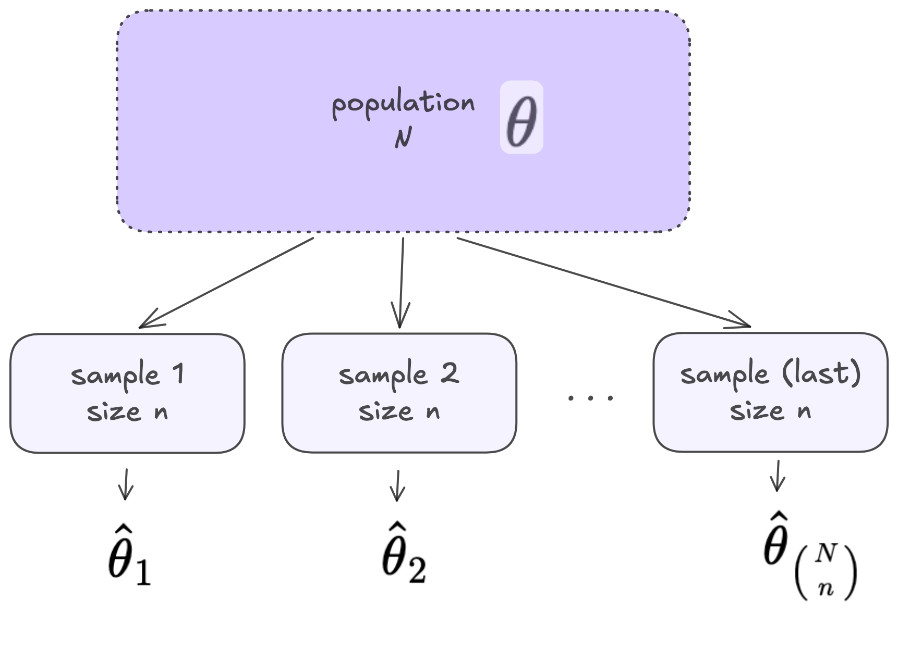
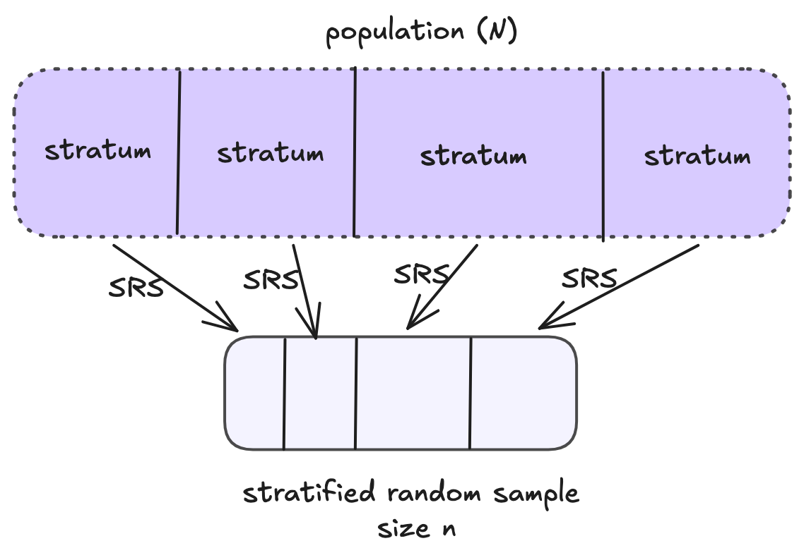
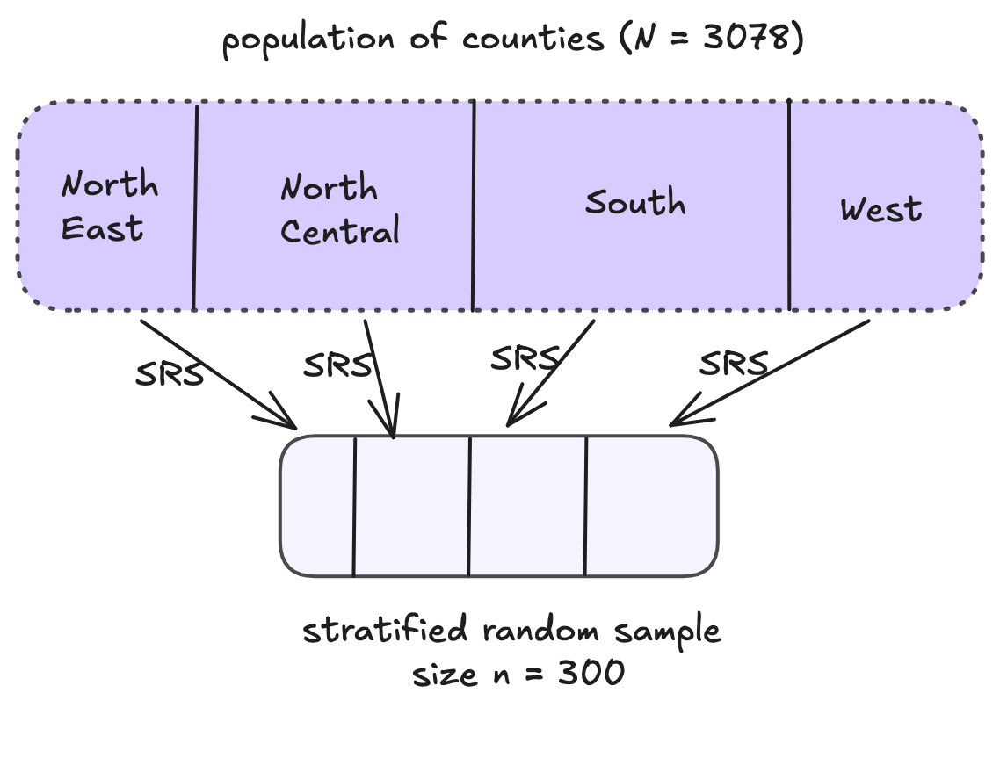

```{r}
#| echo: false

library(tidyverse)
```


# Sampling, Estimation, and Evaluating Estimators

## Review: Sampling and Estimation

{width=60%}

## Review: Sampling Distributions

- A **random variable** is a function that assigns a number to each outcome in the sample space
- The set of possible values of a random variable, along with the probability with which each value occurs is called the **probability distribution** of the random variable

- In sampling, estimators are random variables that can be described by a **sampling distribution**


## Review: Sampling Distributions

{width=40%}

## Review: Random Variables and Expected Value

- Let $X$ be a random variable that can be described by a probability distribution
- **Expected value**: $\mathbb{E}[X]$ is the **long-run average** value of the random variable


## Bias and Variance of Estimation

- The **bias** of an estimator $\hat{\theta}$ is the difference between the expected value of the estimator and the population parameter ($\theta$) it is meant to estimate.
$$Bias[\hat{\theta}] = \mathbb{E}[\hat{\theta}] - \theta$$
- Another important element of estimation is the **variance**: $\mathbb{V}[\hat{\theta}]$. 
- **Mean Squared Error** combines them: $$MSE[\hat{\theta}] = \mathbb{V}[\hat{\theta}] + (Bias[\hat{\theta}])^2$$
  
## Evaluating Estimators


:::columns
:::{.column width=50%}
An estimator $\hat{\theta}$ of $\theta$ is...

  - **unbiased** if $\mathbb{E}[\hat{\theta}] = \theta$
  - **precise** if $\mathbb{V}[\hat{\theta}]$ is small
  - **accurate** if $MSE[\hat{\theta}]$ is small
  
:::
:::{.column width=50%}

{width=25%}
:::
:::

## Expected Value and Variance for Discrete Random Variables

- Let $X$ be a discrete random variable
- $P(X = k)$ is the probability that that random variable $X$ takes the value $k$

$$\mathbb{E}[X] = \sum_k P(X=k)\cdot(k)$$

$$\mathbb{V}[X] = \sum_k  P(X=k) \cdot (k -\mathbb{E}[X] )^2$$

## Expected Value and Variance Rules

- Let $X$ and $Z$ be random variables
- Let $a$ and $b$ be constants

$$\mathbb{E}[aX +b] = a\mathbb{E}[X] + b$$
$$\mathbb{E}[X + Z] = \mathbb{E}[X] + \mathbb{E}[Z]$$

$$\mathbb{V}[aX + b] = a^2\mathbb{V}[X] + 0$$
$$\mathbb{V}[X + Z] = \mathbb{V}[X] + \mathbb{V}[Z] + 2Cov[X, Z]$$

# Estimation with Simple Random Sampling

## Reminder: Simple Random Sampling

- Every possible subset of $n$ units from the population of $N$ units has an **equal probability** of being sampled.


$$P(\mathcal{S}) = \frac{1}{\binom{N}{n}}$$

$$\pi_i = \frac{\text{total number of samples that contain unit } i}{\text{total number of samples of size } n} = \frac{\binom{N-1}{n-1}}{\binom{N}{n}} = \frac{n}{N}$$

## Estimating the Population Mean 

- We are interested in estimating a population mean  for a quantitative variable $$\mu = \frac{y_1 + y_2 + ... + y_N}{N}$$
- We have a SRS if size $n$: $y_1, ..., y_n$ 

- Logical estimator: **sample mean** $$\bar{y} =  \frac{1}{n}\sum_{i = 1}^n y_i$$

## Expected Value of Sample Mean with SRS

- Can show that the sample mean $\bar{y}$ is an *unbiased* estimator for the population mean $\mu$ under SRS.

$\mathbb{E}[\bar{y}]=$


## Estimating  Variation of the Sample Mean with SRS

**In previous statistics courses...**

- Assume **infinite or very large** populations
- For the sampling distribution of the sample mean $\bar{y}$, estimate
$$\hat{SD}(\bar{y}) = SE(\bar{y}) = \sqrt{\frac{s^2}{n}}$$


## Estimating Variation of the Sample Mean with SRS

- Assume a **finite** population
- More or less precision estimating $\mu$?
- You can show that under SRS 
$$\mathbb{V}[\bar{y}]= \frac{N-n}{N}\cdot \frac{\sigma^2}{n}$$so a reasonable estimator is:
$$\hat{\mathbb{V}}(\bar{y}) = \Big(1 - \frac{n}{N}\Big)\frac{s^2}{n}$$

## Finite Population Correction

- **finite population correction (fpc)**: $\frac{N-n}{N} = (1 - \frac{n}{N})$

- $n = 100$, $N = 100,000$
- $n = 100$, $N = 20,00$
- $n = 100$, $N = 204$

## Estimating the Population Total

Population total: $$\tau = y_1 + y_2 + ... + y_N =$$ 

Logical estimator for population total: $$\hat{\tau} = N\bar{y}$$

## Expected Value of $\hat{\tau}$ with SRS

- Can show that the estimator $\hat{\tau} = N\bar{y}$ is an *unbiased* estimator for the population total $\tau$ under SRS.

$\mathbb{E}[\hat{\tau}]=$

## Variance of $\hat{\tau}$ with SRS

Under SRS

$\mathbb{V}[\hat{\tau}]=$


</br>
</br>

So we logically estimate the variance with

$$\hat{\mathbb{V}}[\hat{\tau}] = N(N-1)\frac{s^2}{n}$$

## Summary -- Estimating Means and Totals with SRS

**Mean**

- Sample mean $\bar{y}$ is an **unbiased** estimator of the population mean $\mu$
- Estimate the variance: $\hat{\mathbb{V}}(\bar{y}) = \big(1 - \frac{n}{N}\big)\frac{s^2}{n}$

**Total**

- $\hat{\tau} = N\bar{y}$ is an **unbiased** estimator of the population total $\tau$
- Estimate the variance: $\hat{\mathbb{V}}(\hat{\tau}) = N(N-1)\frac{s^2}{n}$


# Stratified Random Sampling

## Stratified Random Sampling

A **stratified random sample** is one obtained by 

  1. separating the population elements into non-overlapping groups (partitions) called *strata*, then 
  2. selecting a simple random sample from *each stratum*

## Stratified Random Sampling

{width=65%}

## Stratified Random Sampling - Example

**Estimating the total  number of farm acres in the US.**

We have county-level data from the Census Bureau (1995) provided by Sharon Lohr as part of the textbook SDA.

$N = 3078$

```{r}
library(SDAResources)

data(agpop)
nrow(agpop)
```

## Estimating Farm Acres

```{r}
#| layout-ncol: 2
#| echo: false

agpop |> 
  ggplot(aes(x = acres92/1000000)) +
  geom_histogram(bins = 50) +
  labs(x = "Miillions of Acres Devoded to Farms",
       y = "Number of Counties in Population",
       title = "Distribution of Acrees of Farmland for the Population of all US Counties")

set.seed(2943)

agpop_srs <- agpop |> 
  slice_sample(n = 300) 
  
agpop_srs |> 
  ggplot(aes(x = acres92/1000000)) +
  geom_histogram(bins = 50) +
  labs(x = "Millions of Acres Devoded to Farms",
       y = "Number of Counties in Sample",
       title = "Distribution of Acrees of Farmland for a SRS n = 300")
```


```{r}
#| include: false

sd(agpop$acres92, na.rm = T)
sum(agpop$acres92, na.rm = T)

sd(agpop_srs$acres92)
mean(agpop_srs$acres92, na.rm = T)*3078
```

## Estimating Farm Acres

```{r}
#| echo: false

agpop_srs |> 
  filter(acres92/1000000 < 4) |> 
  ggplot(aes(y = region,
             x = acres92/1000000)) +
  geom_boxplot() +
  labs(x = "Millions of Acres Devoded to Farms",
       y = "Region",
       title = "SRS n = 300")
```
## Estimating Farm Acres -- Stratified Sampling

{width=60%}

## Estimating Farm Acres -- Stratified Sampling vs. SRS


$$
\begin{align}
&\frac{\text{estimated variance from stratified sample with } n = 300 }{\text{estimated variance from SRS  with } n = 300} \\
&= \frac{\hat{\mathbb{V}}[\hat{\tau}_{st}]}{\hat{\mathbb{V}}[\hat{\tau}]}\\
&= 0.75
\end{align}
$$


## Stratified Random Sampling vs. SRS

Stratified Random Sampling...

-  gives more precise estimates than SRS IF variation within strata is smaller than the variation overall of the whole population
- can save money
- allows you to estimate population parameters for strata (subgroups of the population)
- ensures you have units from each strata in every sample

## Notation for Stratified Random Sampling

$N$: population size (number of sampling units in the population)

$n$: sample size

$L$: number of strata

$N_{g}$: number of sampling units in stratum $g$

$n_{g}$: number of units **selected** from the $N_{g}$ sampling units in stratum $g$ (strata $g$'s sample size)


## Notation for Stratified Random Sampling

$y_{ig}$: value of the $i^{th}$ unit in stratum $g$

**population parameters**

$\mu_g$: population mean of stratum $g$

$\tau_g$: population total of stratum $g$

$\sigma^2_g$: population variance of stratum $g$


**sample statistics**

$\bar{y}_g$ sample mean for stratum $g$

$s^2_g$: sample standard deviation of stratum $g$

## Notation for Stratified Random Sampling


{width=60%}


## Stratified Sampling in R

:::columns

:::column

Equal $n_g$:

```{r}
## equal n_g for each stratum

agpop_strs <- agpop |> 
  group_by(region) |> 
  slice_sample(n = 75)

nrow(agpop_strs) 
table(agpop_strs$region)
```
:::


:::column

Proportional $n_g$:
```{r}
## proportional n_g for each stratum

agpop_strs <- agpop |> 
  group_by(region) |> 
  slice_sample(prop = 300/3078)

nrow(agpop_strs) 
table(agpop_strs$region)
```
:::
:::