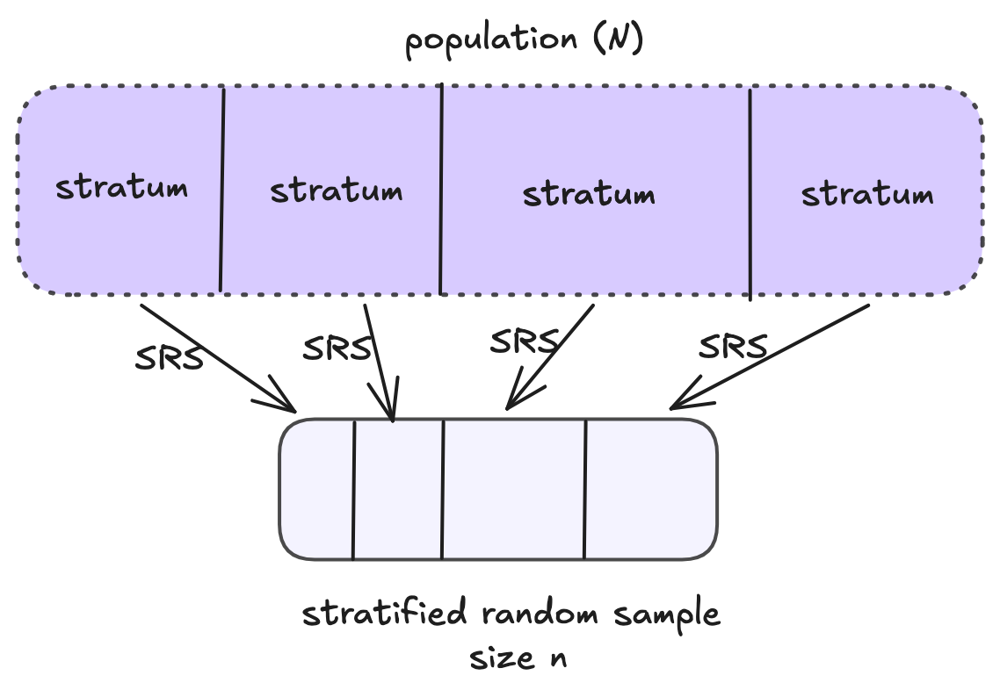
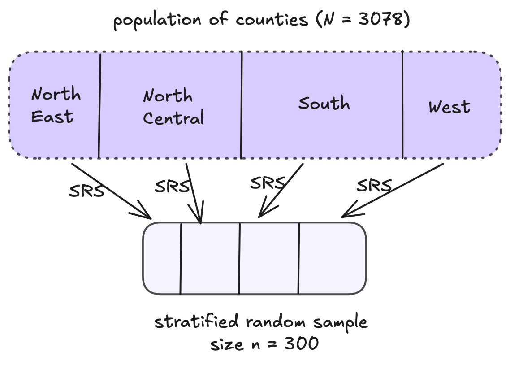

```{r}
#| echo: false

library(tidyverse)
```

# Estimation with Stratified Random Sampling

## Stratified Random Sampling


{width=60%}


## Notation for Stratified Random Sampling

$N$: population size (number of sampling units in the population)

$n$: sample size

$L$: number of strata

$N_{g}$: number of sampling units in stratum $g$

$n_{g}$: number of units **selected** from the $N_{g}$ sampling units in stratum $g$ (strata $g$'s sample size)


## Notation for Stratified Random Sampling

$y_{gi}$: value of the $i^{th}$ unit in stratum $g$

**population parameters**

$\mu_g$: population mean of stratum $g$

$\tau_g$: population total of stratum $g$

$\sigma^2_g$: population variance of stratum $g$


**sample statistics**

$\bar{y}_g = \frac{1}{n_g}\sum_{i = 1}^{n_g} y_{gi}$: sample mean for stratum $g$

$s^2_g$: sample standard deviation of stratum $g$

## Target Population Parameters


$$
\begin{align}
\tau &= \sum_{g=1}^L \sum_{i=1}^{N_g} y_{gi}\\
&= \sum_{g=1}^L
\end{align}
$$
$$
\begin{align}
\mu &= \frac{1}{N}\tau\\
&= \frac{1}{N}\sum_{g=1}^L\qquad\mu_g
\end{align}
$$


## Estimating the Population Mean with Stratified Random Sampling

- Overall population mean: $\mu = \frac{1}{N}\cdot\tau$ 

- Overall population total: $\tau = \displaystyle\sum_{g = 1}^L \tau_g$

- Since the sample in each stratum is a SRS, we know that $\hat{\tau}_g = N_g\bar{y}_g$ is an unbiased estimator for $\tau_g$

- Therefore, an unbiased estimator ($\bar{y}_{st}$) for $\mu$ is:
$\bar{y}_{st} = \frac{1}{N}\displaystyle\sum_{g = 1}^L$

## Estimating the Population Mean with Stratified Random Sampling

$$\bar{y}_{st} = \frac{1}{N}\displaystyle\sum_{g = 1}^L N_g\bar{y}_g$$


$$\hat{\mathbb{V}}[\bar{y}_{st}] = \frac{1}{N^2}\displaystyle\sum_{g = 1}^L N_g^2 \Big(1-\frac{n_g}{N_g}\Big)\Big(\frac{s_g^2}{n_g}\Big)$$

## Estimating the Population Total with Stratified Random Sampling

Therefore, an unbiased estimator for $\tau$ is:

$$\hat{\tau}_{st} = N\bar{y}_{st} = \displaystyle\sum_{g = 1}^L N_g\bar{y}_g$$

And a reasonable estimated variance is:

$$\hat{\mathbb{V}}[N\bar{y}_{st}] = N^2\hat{\mathbb{V}}[\bar{y}_{st}] = \displaystyle\sum_{g = 1}^L N_g^2 \Big(1-\frac{n_g}{N_g}\Big)\Big(\frac{s_g^2}{n_g}\Big)$$

## Estimating Farm Acres -- Stratified Sampling

{width=60%}


## Estimating Farm Acres -- Stratified Sampling


```{r}
#| echo: false
load("_data/agopop.Rdata")

agpop <- agpop |> 
  mutate(acres92mil = acres92/1000000)

set.seed(35340)
agpopsrs <- agpop |> 
  slice_sample(n = 298) |> 
  mutate(N = 3078)


```

:::columns
:::column
```{r}
table(agpop$region)

set.seed(343)

agpop_strat <- agpop |> 
  group_by(region) |> 
  mutate(N_g = n()) |> 
  slice_sample(prop = 300/3078)
```
:::

:::column
```{r}
agpop_strat |> 
  group_by(region, N_g) |> 
  summarize(n_g = n(), 
            ybar_g = mean(acres92mil, na.rm = T),
            sd_g = sd(acres92mil, na.rm = T)) |> 
  knitr::kable(digits = 3) 
```
:::

:::


## Estimating Mean and Total Farm Acres -- Stratified Sampling

:::columns

:::{.column width=60%}

$\bar{y}_{st} = \frac{1}{N}\displaystyle\sum_{g = 1}^L N_g\bar{y}_g$


</br>
</br>
</br>
</br>
</br>

$\hat{\tau}_{st} = N\bar{y}_{st} =$


:::


:::{.column width=40%}


```{r}
#| code-fold: true

agpop_strat |> 
  group_by(region, N_g) |> 
  summarize(n_g = n(), 
            ybar_g = mean(acres92mil, na.rm = T),
            sd_g = sd(acres92mil, na.rm = T)) |> 
  knitr::kable(digits = 3) |> 
  kableExtra::kable_styling(font_size = 25)
```
:::
:::


## Estimating Variability of Estimated Farm Acres 


:::columns

:::{.column width=60%}

$\hat{\mathbb{V}}[\bar{y}_{st}] = \frac{1}{N^2}\displaystyle\sum_{g = 1}^L N_g^2 \Big(1-\frac{n_g}{N_g}\Big)\Big(\frac{s_g^2}{n_g}\Big)$


</br>
</br>
</br>
</br>
</br>

$\hat{\mathbb{V}}[\hat{\tau}_{st}]  =$


:::


:::{.column width=40%}


```{r}
#| code-fold: true

agpop_strat |> 
  group_by(region, N_g) |> 
  summarize(n_g = n(), 
            ybar_g = mean(acres92mil, na.rm = T),
            sd_g = sd(acres92mil, na.rm = T)) |> 
  knitr::kable(digits = 3) |> 
  kableExtra::kable_styling(font_size = 25)
```
:::
:::

## Using `R` for Sampling Estimates - `survey` package


```{r}
library(survey)
```

**Step 1: Set Up Design**

:::columns
:::column
**SRS**
```{r}
srs_des <- svydesign(id = ~1, 
                     data = agpopsrs,
                     fpc = ~N,
                     na_weights = "warn")
```
:::
:::column
**Stratified**
```{r}
strat_des <- svydesign(id = ~1,
                       data = agpop_strat,
                       strata = ~region,
                       fpc = ~N_g,
                       na_weights = "warn")
```
:::
:::

## Using `R` for Sampling Estimates - `survey` package

**Step 2: Estimates**

:::columns
:::column
**SRS**

```{r}
# mean or prop
svymean(~acres92mil, design = srs_des, na.rm = T)
```

```{r}
# total
svytotal(~acres92mil, design = srs_des, na.rm = T)
```
:::
:::column
**Stratified**
```{r}
# mean or prop
svymean(~acres92mil, design = strat_des, na.rm = T)
```

```{r}
# total
svytotal(~acres92mil, design = strat_des, na.rm = T)
```
:::
:::

## What if we used the wrong design for estimation?


:::callout-warning
## Wrong analysis -- ignoring strata in estimation

```{r}
#| echo: false 

agpop_strat <- agpop_strat |> 
  ungroup() |> 
  mutate(N = 3078)
```


```{r}
incorrect_des <- svydesign(id = ~1, 
                        data = agpop_strat,
                        fpc = ~N,
                        na_weights = "warn")


```


```{r}
# mean or prop
svymean(~acres92mil, design = incorrect_des, na.rm = T)

# total
svytotal(~acres92mil, design = incorrect_des, na.rm = T)
```
:::

# Determining Sample Size

## Extension: Estimating Population Proportions

- We haven't talked about estimating population proportions yet...
- This is because a **proportion** is just a special **mean** where the outcome variable is **binary**

$$
y_i =
  \begin{cases}
    1       & \quad \text{if ``success"}\\
    0      & \quad \text{if ``failure"}
  \end{cases}
$$
**SRS:** $p = \frac{1}{N}\displaystyle\sum_{j=1}^N y_i = \frac{\text{\# successes}}{N} \qquad \qquad \hat{p} = \frac{1}{n}\displaystyle\sum_{j=1}^n y_i = \frac{\text{\# successes}}{n}$

## Review: Population Proportions

Population: 

  - $p$ is the population proportion of successes
  - $\sigma^2 = p(1-p)$ is the population variance
  
Sample:

  - $\hat{p}$ is the sample proportion of successes
  - $\mathbb{E}[\hat{p}] = p$ 
  - In previous classes with infinite populations: $\mathbb{V}[\hat{p}] = \frac{p(1-p)}{n}$


## Estimating Population Proportions

**SRS**

| Estimator     | |
|---------------|-----|
| Point | $\hat{p} = \bar{y} =  \frac{1}{n}\sum_{i=1}^ny_i$|   
| Variance | $\hat{\mathbb{V}}(\hat{p}) = \Big(1 - \frac{n}{N}\Big)\frac{\hat{p}(1-\hat{p})}{n-1}$    | 

: {tbl-colwidths="[10,50]"}

**Stratified**

| Estimator     |  |
|---------------|------------|
| Point  |   $\hat{p}_{st} = \bar{y}_{st} = \frac{1}{N}\sum_{g=1}^LN_g\hat{p}_g$        |
| Variance   |     $\hat{\mathbb{V}}(\hat{p}_{st}) = \frac{1}{N^2}\sum_{g=1}^LN_g^2\Big(1 - \frac{n_g}{N_g}\Big)\frac{\hat{p}_g(1-\hat{p}_g)}{n_g-1}$       |

: {tbl-colwidths="[10,50]"}


## Review: Confidence Intervals

$$\hat{\theta} \pm \text{critical value} \times SE(\hat{\theta})$$

95% CI: $\hat{\theta} \pm 2 \times SE(\hat{\theta})$


## Bound on Error of Estimation

Simple Random Sampling for population mean:

$$B = 2\sqrt{\Big(\frac{N-n}{N-1}\Big)\frac{\sigma^2}{n}}$$

Stratified Random Sampling for population mean:

$$B = 2\sqrt{\sum_{g=1}^L \Big(\frac{N_g}{N}\Big)^2 \Big(\frac{N_g-n_g}{N_g-1}\Big)\frac{\sigma_g^2}{n_g}}$$

## Determining Sample Size - Big Idea


$$B = 2\sqrt{\Big(\frac{N-n}{N-1}\Big)\frac{\sigma^2}{n}}$$

$$\hat{y} \pm B$$


## Calculating Sample Size -  SRS

Sample size required to estimate the population **mean**, $\mu$, or **total**, $\tau$ with a bound on the error of estimation $B$:

$$n = \frac{N\sigma^2}{(N-1)D + \sigma^2}$$

where $$D = \frac{B^2}{4} \text{ when estimating } \mu$$
$$D = \frac{B^2}{4N^2} \text{ when estimating } \tau$$

## Calculating Sample Size -  SRS

Sample size required to estimate the population **proportion** $p$ with a bound on the error of estimation $B$:

$$n = \frac{N p(1-p)}{(N-1)D + p(1-p)}$$


where $$D = \frac{B^2}{4} \text{ when estimating } p$$

## Calculating Sample Size - Stratified Random Sampling

Multi-step process:

1. Determine how you want to *allocate*  the sample size between clusters
  $$n_g = a_g n \qquad \text{    for } g = 1, ..., L \text{ and } a_1 + ... + a_L = 1$$
$$a_g\text{ is the proportion of sampling units allocated to stratum }g$$

2. Determine the overall sample size $n$ given a bound $B$
3. Calculate the appropriate stratum sizes $n_1, ..., n_L$, given $n$ and the chosen allocation


## Calculating Sample Size - Stratified Random Sampling

*Approximate* sample size required to estimate the population **mean**, $\mu$, or **total**, $\tau$ with a bound on the error of estimation $B$:

$$n = \frac{\displaystyle\sum_{g=1}^L N_g\sigma_g^2/a_g}{(N-1)D + \sigma^2}$$

where $a_g$ is the fraction of observations *allocated* to stratum $g$ and $$D = \frac{B^2}{4} \text{ when estimating } \mu, \quad D = \frac{B^2}{4N^2} \text{ when estimating } \tau$$

## Stratified Random Sampling -- How to Choose Allocation?

Consider three factors:

1. $N_g$:
2. $\sigma^2_g$:
3. $c_g$: Cost of obtaining an observation in each stratum 

Three types of allocations:

- Proportional Allocation
- Optimal Allocation
- Neyman Allocation

## Proportional Allocation

- number of sampled unit in each stratum is proportional to the size of the stratum.

$$a_g = \frac{N_g}{N} \quad \quad n = \frac{\displaystyle\sum_{g=1}^L N_g\sigma_g^2}{ND + \displaystyle\sum_{g=1}^L\frac{N_g}{N}\sigma_g^2}$$

$\pi_{gi} =$


- Use when: cost of sampling and variances are approximately equal for all strata

## Optimal Allocation

- Increases precision if stratum variances vary across strata
  - minimizes variance for a fixed total cost or
  - minimizes cost for a fixed variance (i.e. fixed B)


$$a_g = \frac{N_g\sigma_g^2/\sqrt{c_g}}{\sum_{h = 1}^L N_h\sigma_h/\sqrt{c_g}} \quad \quad n = \frac{\Big(\displaystyle\sum_{g=1}^L N_g\sigma_g/\sqrt{c_g}\Big)\Big(\displaystyle\sum_{g=1}^L N_g\sigma_g\sqrt{c_g}\Big)}{N^2D + \displaystyle\sum_{g=1}^LN_g\sigma_g^2}$$

- Use when: costs of sampling and stratum variances vary across strata

## Neyman Allocation

- special case of optimal allocation when costs are similar between strata
- will support more precise estimation than proportional allocation if stratum variances are specified correctly


$$a_g = \frac{N_g\sigma_g^2}{\sum_{h = 1}^L N_h\sigma_h} \quad \quad  n = \frac{\Big(\displaystyle\sum_{g=1}^L N_g\sigma_g\Big)^2}{N^2D + \displaystyle\sum_{g=1}^LN_g\sigma_g^2}$$

- Use when:  stratum variances vary across strata *but* costs of sampling are the same

## Determining Sample Size and Allocation for Estimating Proportions

- Remember, the population proportion $p$ and sample proportion $\hat{p}$ are just special cases of means where $y$ is a binary variable.
- Follow the equations for estimating the population mean $\mu$ but **substitute**
  -  for the overall population variance: $p(1-p) = \sigma^2$
  - for a stratum population variance: $p_g(1-p_g) = \sigma_g^2$
  

## Summary of Allocations

- **Proportional** Allocation
  - Cost of sampling **and** variances are approximately **equal** for all strata
  - Size (either), Variability (equal), Cost (equal)
  - Usually do this!
- **Optimal** Allocation
  - Costs of sampling **and** stratum variances **vary** across strata
  - Size (equal), Variability (VARY), Cost (VARY)
- **Neyman** Allocation
  - **only costs** of sampling **vary** across strata
  - Size (either), Variability (VARY), Cost (equal)

## Summary

To determine a sample size, 


1. Determine your desired maximum bound of error $B$
2. Approximate population variance(s) using one of the options...
    - historical data, a pilot study, or
    - estimating $\mu$ or $\tau$? **last resort** $\rightarrow$ (range of variable)/4
    - estimating $p$? **last resort** $\rightarrow$ use $p = 0.5$ or for a conservative estimate
3. **If stratified sample**, choose allocation type
3. Calculate $n$ for the appropriate population parameter and study design, given (1) the bound you chose, (2) approximated population variances, and (3) allocations if appropriate
3. **If stratified sample**, calculate stratum sample sizes ($n_g$'s) from $n$ and allocations

