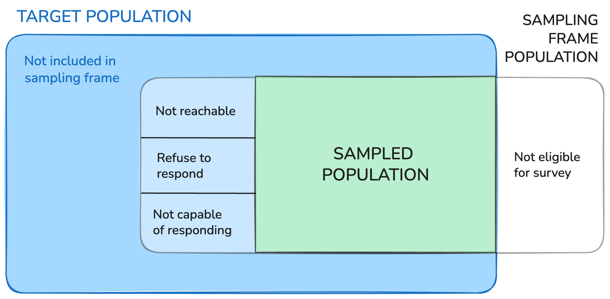

```{r}
#| echo: false

library(tidyverse)
library(gt)
```

# Survey Weights

## Complex Sampling Designs

- Most sample surveys in real life use *complex sampling designs*
- One or more of the following:

:::columns
:::column
1. stratification
2. clustering
3. unequal probabilities of selection
4. multiple stages of selection
5. systematic selection
:::
:::column
:::callout-tip
## This class

In this class we are only covering **stratification** formally, but I want you to be aware that there are many more complex things to do!
:::
:::
:::

## Complex Sampling Designs -- Estimation

There are two elements of complex sampling designs that must be taken into account to make valid inferences:

1. Different probabilities of selection in sampling for sampling units.

</br>

2. Variation associated with sampling design.

## Survey Weights -- accounting for complexities!

If...

  - units in the population have **different probabilities** of being selected in the sample
  - there is **nonresponse**
  - there are frame deficiencies (**coverage** issues)

## Survey Weights -- Big Picture

Let $w_j$ be a weight for unit $j$

$$\hat{\mu}_w = \frac{\sum w_jy_j}{\sum w_j} \qquad \qquad \hat{\tau}_w = N\frac{\sum w_jy_j}{\sum w_j}$$

</br>

:::callout-note
## Estimating Variability

As always we don't just care about the **point** estimates $\hat{\mu}_w$ and $\hat{\tau}_w$, but also  how much **sampling variability** there is in these estimates!

There is a special way to estimate the variability, $SE(\hat{\mu}_w)$ and $SE(\hat{\tau}_w)$...

... we are just goint to let the `survey` package in `R` handle it

:::


## Unequal Probabilities of Selection

- Reminder: $\pi_j$ is the probability of **unit** $j$ of being selected in the sample

$$w_j = \frac{1}{\pi_j}$$


## Survey Weights with Stratification

- You have seen them before!!
 $$w_{gi} = \frac{1}{\pi_{gi}} = \frac{N_g}{n_g}= w_g$$
 
$$\hat{\mu}_w = \bar{y}_{st} = \frac{1}{N}\displaystyle\sum_{g = 1}^L N_g\bar{y}_g$$

... let's do the math

## Survey Weights with Stratification

$\hat{\mu}_w = \frac{\sum w_jy_i}{\sum w_j}  = \frac{\displaystyle\sum_{g=1}^L \sum_{i=1}^{n_g}\frac{N_g}{n_g} y_{gi}}{\displaystyle\sum_{g=1}^L \sum_{i=1}^{n_g} \frac{N_g}{n_g}}$

## Example: Reading Comprehension

```{r}
#| echo: false

readingdat <- read_csv("../3-activities/_data/10-sixthgrade.csv") |> 
  janitor::clean_names() |> 
  select(-question)

```

:::columns

:::{.column}

```{r}
#| echo: false

readingdat |> 
  group_by(track) |> 
  slice_sample(n = 2) |> 
  knitr::kable()
```
:::
:::{.column}

```{r}
#| code-fold: true

readingdat |>
  ggplot(aes(x = track, y = scores)) +
  geom_boxplot() +
  geom_jitter(height = 0, width = .2,
              alpha = .7, color = "#154734",
              size = 2) +
  labs(x = "Track", y = "Score",
       title = "Distribution of Reading Comprehension Scores by Track for Stratified Sample of 6th Graders") 
```
:::
:::

## Reading Comprehension - Weights

:::columns
:::column
```{r}
table(readingdat$track)
```

:::

:::column
```{r}
readingdat <- readingdat |> 
  mutate(weight = size/n(), .by = track)
```

```{r}
#| code-fold: true
readingdat |> 
  slice_sample(n = 1, by = track) |> 
  knitr::kable() |> 
  kableExtra::kable_styling(font_size = 30)
```
:::

:::

## Estimation in R

```{r}
library(survey)
```

</br>

:::columns
:::column
```{r}
strat_des <- svydesign(ids = ~1,
                       strata = ~track,
                       fpc = ~size,
                       data = readingdat)

svymean(~scores, strat_des)
```
:::
:::column
```{r}
strat_des_w <- svydesign(ids = ~1,
                       strata = ~track,
                       weights = ~weight,
                       data = readingdat)

svymean(~scores, strat_des_w)
```

:::
:::

## Example: Florida Building Permits (Ex 11.6 in [ESS](https://csu-calpoly.primo.exlibrisgroup.com/discovery/fulldisplay?docid=alma991070566017102901&context=L&vid=01CALS_PSU:01CALS_PSU&lang=en&search_scope=Everything&adaptor=Local%20Search%20Engine&tab=Everything&query=any,contains,elementary%20survey%20sampling&offset=0))

:::columns
:::column
**Goal**: Estimate total number of building permiits for housing units issued in Florida in 2000

**Sample**: 10 of Floridas 67 counties by dropping 10 random points on the **map** of the state
:::
:::column
```{r}
#| echo: false
counties <- c("Alachua","Santa Rosa","Polk","Palm Beach",
             "Collier","Orange","Suwannee","Volusia",
             "Wakulla","Hillsborough")

florida_map <- map_data("county") |> 
  filter(region == "florida")   |> 
  mutate(in_sample = str_to_title(subregion) %in% counties)
```


```{r}
#| echo: false
#| fig-width: 6

florida_map |> 
  ggplot(aes(x = long, y = lat, group = group,
             fill = in_sample)) +
  geom_polygon(color = "grey25",
               linewidth = .1) +
  scale_fill_manual(values = c("grey80","#f768a1"),guide = "none") +
  coord_map("albers",  lat0 = 45.5, lat1 = 29.5) +
  xlab("") + ylab("") +
  theme(plot.title = element_text(hjust = 0.5),
        panel.border = element_blank(),
        panel.grid.major = element_blank(),
        panel.grid.minor = element_blank(),
        axis.text = element_blank(),
        axis.ticks = element_blank(),
        legend.position = "none",
        plot.margin = margin(0, 0, 0, 0, "cm"),
        panel.background = element_rect(fill = "white"))
```
:::
:::


##  Example: Florida Building Permits

- The probability of selecting a county is proportional to the size or area of the county  $A_i$ 
- Let $k$ be the total area of Floria
$\rightarrow \pi_i = \frac{A_i}{k}$
- Note: for estimating the population mean, we don't need to know $k$! 
$$\hat{\mu}_w = \frac{\sum \frac{k}{A_i}y_i}{\sum \frac{k}{A_i}} = \qquad\qquad\quad = \frac{\sum \frac{1}{A_i}y_i}{\sum \frac{1}{A_i}}$$

## Example: Florida Building Permits

```{r}
#| echo: false

# copy this code if you want to play with this data!

florida_permits <- tibble(
  county = c("Alachua","Santa Rosa","Polk","Palm Beach",
             "Collier","Orange","Suwannee","Volusia","Wakulla","Hillsborough"),
  area = c(874, 1017, 1874, 1974, 2025, 907, 688, 1103, 607, 1051),
  permits = c(1973, 1056, 4746, 10504, 7970, 10239, 125, 3587, 394, 11656)
)  |> 
  mutate(weight = 1/area)
```

```{r}
#| echo: false

florida_permits |> 
  gt() |> 
  tab_options(table.font.size = 22) |>
  tab_header(
    title = "Florida Housing Permit Data",
    subtitle = "Table 11.1 in ESS"
  ) |> 
  tab_style(style = cell_text(align = "center"),
    locations = cells_column_labels()) |> 
  cols_align(align = "left",
             columns = county) |> 
  fmt_number(columns = c(area, permits),
             decimals = 0) |> 
  fmt_number(columns = weight,
             decimals = 3,
             scale_by = 100) |> 
  tab_footnote(
    footnote = "Weights are multiplied by 100 for visibility.",
    locations = cells_column_labels(columns = weight)
  ) |> 
    cols_label(
    county = md("**County**"),
    area = md("**Area ($A_i$)**"),
    permits = md("**\\# Permits ($y_i$)**"), 
    weight = md("**Weight ($w_i$)**"),
    ) 
  
  
```


##  Example: Florida Building Permits {.smaller}

```{r}
#| code-fold: true

# copy this code if you want to play with this data!

florida_permits <- tibble(
  county = c("Alachua","Santa Rosa","Polk","Palm Beach",
             "Collier","Orange","Suwannee","Volusia","Wakulla","Hillsborough"),
  area = c(874, 1017, 1874, 1974, 2025, 907, 688, 1103, 607, 1051),
  permits = c(1973, 1056, 4746, 10504, 7970, 10239, 125, 3587, 394, 11656)
)  |> 
  mutate(weight = 1/area)
```

```{r}
y_i <- florida_permits$permits
w_i <- 1/florida_permits$area
N <- 67
```

:::columns
:::{.column width=48%}
**Ignored** the unequal probability of sampling and treat this like a SRS ...  
```{r}
(muhat_srs <- sum(y_i)/10) 
N*muhat_srs
```

estimate the total as 350,075 permits with an SE of 87,904 permits
:::
:::{.column width=4%}
:::
:::{.column width=48%}
**Correctly** account for unequal probability with weights:

```{r}
(muhat_w <- sum(w_i*y_i)/sum(w_i)) 
N*muhat_w
```
estimate the total as 386,297 permits with an SE of 94,873 permits.
:::
:::

# Accounting for Nonresponse and Other Uses for Weights


## Nonresponse

- In real life, you are going to have nonresponse
- *Nonrespondent*: any eligible sample unit for which data are not obtained because the unit refuses to answer, is not reachable, or cannot answer for any number of reasons
- **Nonresponse error** just refers to the presence of nonresponse

## Nonresponse Bias

- **Nonresponse bias** occurs when nonrespondents both:
    1. differ systematically from respondents in characteristics related to the response of interest and
    2. are a large eough proportion of the population that this difference impacts the survey estimates.
- Adjust for nonresponse bias using weights!

## Reminder: Weighted Estimators

Let $w_j$ be a weight for unit $j$

$$\hat{\mu}_w = \frac{\sum w_jy_j}{\sum w_j}  \qquad \qquad \hat{\tau}_w = N\frac{\sum w_jy_j}{\sum w_j}$$


## Trade-off for Adjustment for Nonresponse

- Adjusting with weights decreases bias but can increase variance


</br>
</br>

- Are there sub-groups of your population that you think will have relatively constant nonresponse rates within them?
 
## Weighted Estimator for Strata

- With stratified sampling all units in a strata typically have the same weight... so we can simplify to...
- Let $w_g$ be a weight for **strata** $g$
- and $Y_g = \sum_{i=1}^{n_g} y_{gi}$ be the **total** of the response of interest $y_{gi}$ for **strata** $g$

$$\hat{\mu}_w = \frac{\sum w_gY_g}{\sum w_g n_g}  \qquad \qquad \hat{\tau}_w = N\frac{\sum w_gY_g}{\sum w_g n_g}$$

## Example: SLO Medical Care

A stratified sample of 1,000 households is selected from two regions (North and South) in SLO county.

- 2 Strata: North and South County
- Suppose there are 40,000 households in North county and 120,000 in South county.
- North county sample size is set at 400 and South county is 600 households.
- **Goal**: estimate the *proportion* of households with access to primary health care in SLO county

## Example: SLO Medical Care


| Strata        | $N_g$   | $n_g$   | Base Weight |
|---------------|-----|-----|-------------|
| North (g = 1) |  40,000   |  400   |             |
| South (g = 2) |   120,000  |  600   |             |

Calculating base weight $w_g$?
<br>

$w_1$ = 

<br>

$w_2$ = 

## Example: SLO Medical Care


| <br> Strata | <br> N   | <br> n  | \# responses <br> $n^*_g$ | \# of "yes" <br> $x_g$ | Base Weight |
| ------- | ---: | ---: | :-----: | :----: | :---: |
| North (g = 1) | 40,000    |  400   |    200  |   170   |     [100]{style="color:blue;"}        |
| South (g = 2) | 120,000    |   600  |     530          |     330          |     [200]{style="color:blue;"}        |

Let $x_g = \sum_{i=1}^{n_g} y_{gi}$ where $y_{gi}$ is a binary variable that takes the value of 1 if the household has access to primary healthcare.

## Example: SLO Medical Care

| <br> Strata | <br> N   | <br> n  | \# responses <br> $n^*_g$ | \# of "yes" <br> $x_g$ | Base Weight |
| ------- | ---: | ---: | :-----: | :----: | :---: |
| North (g = 1) | 40,000    |  400   |    200  |   170   |     [100]{style="color:blue;"}        |
| South (g = 2) | 120,000    |   600  |     530          |     330          |    [200]{style="color:blue;"}          |

:::columns
:::column
- **Unweighted** estimated proportion of households with
access to primary health care:

$\hat{p} = \frac{\sum x_g}{\sum n^*_g}=$
:::
:::column
- **Weighted** estimated proportion:

$\hat{p}_w = \frac{\sum w_gx_g}{\sum w_gn^*_g}  =$
:::
:::

## Adjusting for Nonresponse

- Simply adjust the base weight taking into account the
response rate.
- Get a new weight, adjusted for nonreponse
- Let $r_g$ be the response rate for strata $g$

Nonresponse adjusted base weight =   $[\text{base weight}]\times[\frac{1}{\text{response rate}}]$

$$w^*_g = \frac{w_g}{r_g}$$

## SLO Medical Care -- Adjusting for Nonresponse

| <br> Strata | <br> $N_g$   | <br> $n_g$  | \# resp. <br> $n^*_g$ | resp. rate <br> $r_g$ |\# "yes" <br> $x_g$ |  <br> $w_g$ |  <br> $w^*_g$ |
| ----- | ---: | ---: | :-----: | :-----: | :----: | :---: | :---: |
| North | 40,000    |  400   |    200 | |   170   |     [100]{style="color:blue;"}   | |
| South | 120,000    |   600  |     530      |    |     330  |     [200]{style="color:blue;"}    | |


<br>
$r_1= \qquad \qquad \qquad \qquad \qquad \qquad r_2=$


<br>


$w_1^*=  \qquad \qquad \qquad \qquad  \qquad \qquad w_2^*=$


## SLO Medical Care -- Adjusting for Nonresponse

| <br> Strata | <br> $N_g$   | <br> $n_g$  | \# resp. <br> $n^*_g$ | resp. rate <br> $r_g$ |\# "yes" <br> $x_g$ |  <br> $w_g$ |  <br> $w^*_g$ |
| ----- | ---: | ---: | :-----: | :-----: | :----: | :---: | :---: |
| North | 40,000    |  400   |    200 |[0.50]{style="color:green;"} |   170   |    [100]{style="color:blue;"}   | [200]{style="color:green;"} |
| South | 120,000    |   600  |     530      |  [0.88]{style="color:green;"}  |     330  |    [200]{style="color:blue;"}    | [226]{style="color:green;"} |


- **Weighted non-response adjusted** estimated proportion of households with access to primary health care is:

$\hat{p}_{adj} = \frac{\sum w^*_gx_g}{\sum w^*_gn^*_g}  =$

## Comparing Estimators

| Estimator | $\hat{p}$ | $SE(\hat{p})$ |
|-------|---|---|
|Unweighted|0.685 | 0.015 |
|Strata Weighted| 0.659 | 0.0008 |
|Nonresponse Adjusted Weighted| 0.679 | 0.0008 |

<br>

- North county observed prop: $\hat{p}_1 = \frac{170}{200} = 0.85$ 
- South county observed prop: $\hat{p}_2 = \frac{330}{530} = 0.622$

```{r}
#| echo: false
#| include: false

N_g <- c(40000, 120000)
n_g <- c(400, 600)
w_g <- N_g/n_g
nstar_g <- c(200, 530)
y_g <- c(170, 330)
p_g <- y_g/nstar_g
wstar_g <- w_g/(nstar_g/n_g)

phat <- sum(y_g)/sum(nstar_g)
sqrt(phat*(1-phat)/1000)

sum(y_g*w_g)/sum(w_g*nstar_g)
sqrt(sum(w_g^2*p_g*(1-p_g)) / sum(w_g*nstar_g)^2)

sum(y_g*wstar_g)/sum(wstar_g*nstar_g)
sqrt(sum(wstar_g^2*p_g*(1-p_g)) / sum(wstar_g*nstar_g)^2)


```


## Weights for other Representation Issues

- Use weights if...
    - units in the population have **different probabilities** of being selected in the sample
    - there is suspected **nonresponse bias**
    - there is suspected **coverage bias** 

- Weights often address ALL THREE of these issues in complex surveys
- This is a big part of the job of survey experts! 

## Weights in Administrative Data

> includes person weights that estimate the number of people in the target population that each person represents. In general, since population units may be sampled with different selection probabilities and since response rates and coverage rates may vary across subpopulations, different responding units represent different numbers of units in the population. The use of weights in survey analysis compensates for this differential representation, thus producing estimates that relate to the target population.
- [Census Bureau](https://www.census.gov/programs-surveys/sipp/methodology/weighting.html)

> Researchers using BRFSS data should conduct analyses with complex sampling procedures; they also should appropriately stratify and weight the data in their work. Potential bias resulting from selection probabilities and noncoverage among segments of the population can be reduced through weighting. 
- [BRFSS](https://www.cdc.gov/brfss/annual_data/2025/pdf/Complex-Sampling-Weights-and-Preparing-Module-Data-for-Analysis-2025-508.pdf)

## Weights in Administrative Data

- Often, big surveys stratify on **some variables** like states, counties, etc.
- But it is difficult to stratify on demographic information... 
- After the sample is collected, calculate weights based on discrepenciess between demographics of the sample and known demographics of the population (from the Census)

## Example: SLO Medical Care


| Strata        | Income | Pop Size      | \# resp.  | \# yes |
|---------------|--------|--------|-----------|---------|
| North (g = 1) | High   | 20,000 | 120       | 110     |
| North (g = 1) | Low    | 20,000 | 80        | 60      |
| South (g = 2) | High   | 80,000 | 360       | 250     |
| South (g = 2) | Low    | 40,000 | 170       | 80      |

## Calculating Weights

Example procedure:

1. Calculate base weight based on probability of selection
2. Adjust for nonresponse
3. *Poststratification* adjustment to correct for departures from known population totals

and there may be other layers of adjustments for other elements of the complex sampling design!

## Weighty Lessons

- The big picture here is: pay attention to whether data you are analyzing gives you survey weights!!
- You *need* to use a weighted analysis if weights are provided to be able to generalize to the intended target population
- It is hard to get a *perfect* sample -- weights help us adjust things in a principled way to generalize back to the target population

{width=30%}

