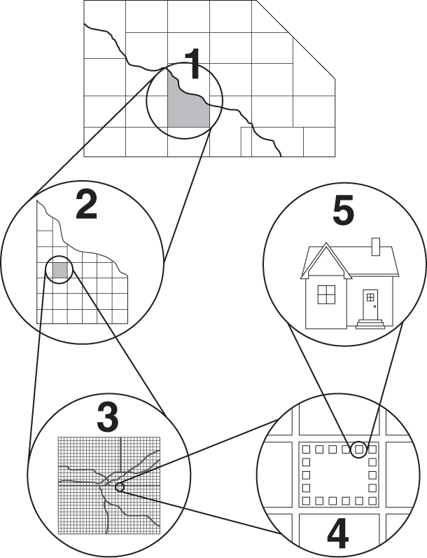
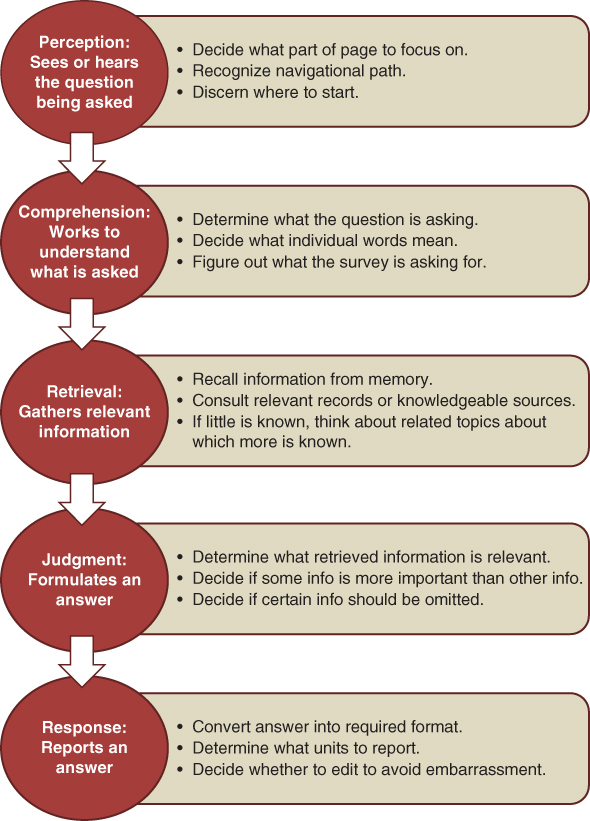
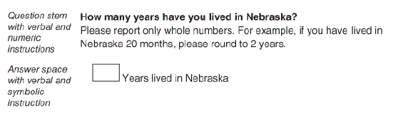
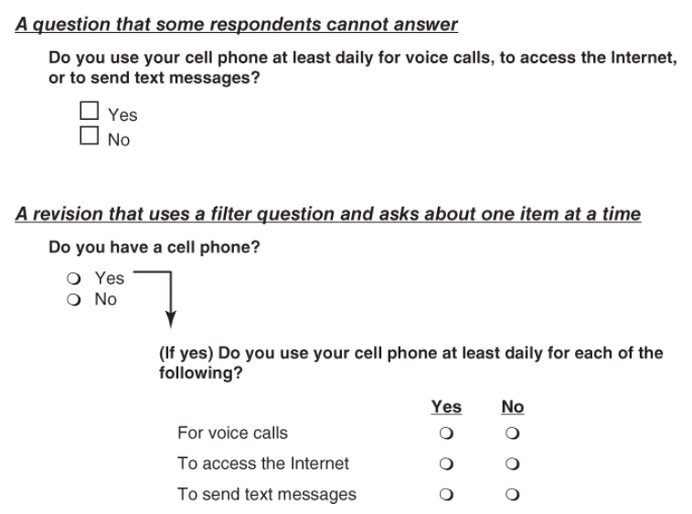
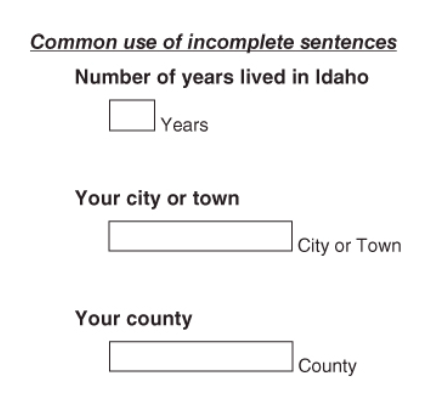
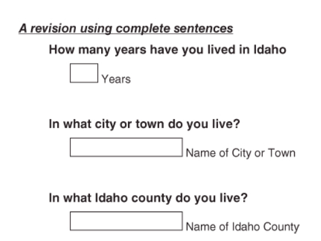
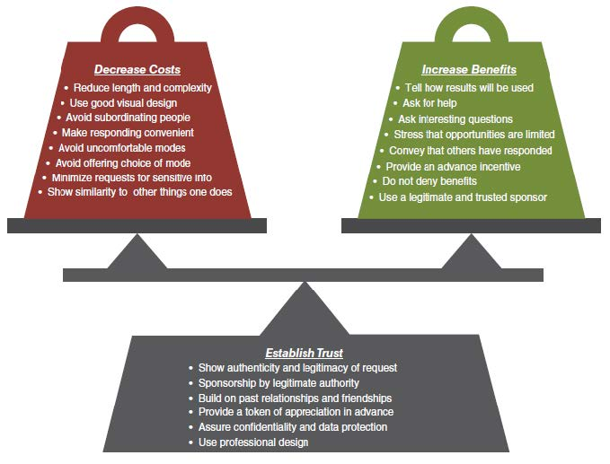

```{r}
#| echo: false

library(tidyverse)
library(gt)
```

# Practical Distribution and Coverage Considerations


## Focus: Surveys with Humans and Questionnaires

- Survey sampling does not need to include a questionnaire 
  - Ex: testing a sample of products
  - Ex: stars in the sky
- This week, we will focus on the practicalities of implementing surveys with humans and questionnaires
- Texbook: *Internet, Phone, Mail, and Mixed-Mode Surveys: The Tailored Design Method* (2014) by Dillman, Smyth, and Christian.

## Sources of Errors in Surveys

- **Errors of nonobservation**: the sampled elements do not cover the entire target population
  - Sampling
  - Coverage
  - Nonresponse
- **Errors of observation**: recorded data don't reflect the "truth"
  - Interviewer
  - Respondents
  - Instrument
  - Method of data collection

## Coverage Issues in Practice

- How are surveys *actually* implemented?
  - Telephone surveys
  - Web surveys
  - Mail or home surveys
- Each of these methods of distribution of a survey instrument have different coverage implications

## Telephone Surveys

- **Random Digit Dialing**
    - Can be considered a probability sample
    - What kinds of numbers to include?
- According to research folks with **cell phones only** are more likely to be:
    - young
    - racial and ethnic minorities
    - renters
    - making incomes below the poverty line
    
## Telephone Surveys -- Coverage Issues

- For adequate coverage, need to include both landline and cell phone numbers
- Other issues:
  - increase in unsolicited phone calls
  - decrease contact and cooperation rates
  - people move so the area code doesn't necessarily capture people who still live in that state / county
  
## Web Surveys

- No "internet" population frame! 🧐
- List of emails?
- Catch people while they are on the internet?
- **Survey panels**
  - Companies recruit *large* panels of individuals who agree to respond to web surveys.
  - As the surveyor, when you work with the panel, you can specify *quota* sampling
  
## Web Surveys

:::callout-important
### Large sample fallacy

With web surveys, it is easy to get a **large** sample, but that does not mean it is a **representative** sample!!
:::

- Sample includes people who have opted-in to the panel
  - These are folks who are on the panel to make money taking a variety of surveys! 
- Who is likely not represented?


## Mail / Home Surveys
:::columns
:::column
- Area Probability Sampling
- Address-Based Sampling
  - USPS has lists of all delivery spots on all routes
  - Not publicly available
- These can be genuine probability samples...
- ... but who will respond?

:::
:::column
{width=50%}
:::
:::

## Evaluating Sampling Frames

1. Does the sampling frame contain everyone in the target population?
2. Does the sampling frame include peopel who are not in the target population?
3. Are the same sample units included on the frame more than once?
4. How is the frame maintained and updated?
5. Does the frame contain other informaiton that can be helpful to improve the survey?


# Fundamentals of Instrument Design


## Sources of Errors in Surveys

- **Errors of nonobservation**: the sampled elements do not cover the entire target population
  - Sampling
  - Coverage
  - Nonresponse
- **Errors of observation**: recorded data don't reflect the "truth" -- i.e. measurement error
  - Interviewer
  - Respondents
  - Instrument
  - Method of data collection
  
## Interviewer

:::callout-tip
## Interviewer Influence?

How can the presence of interviewers affect responses on individual questions?
:::

:::columns
:::column
**Positives:**

- extra motivation and assistance
- clarify meaning of questions
- probe for more complete answers
- controls question order and time in each question

:::
:::column
**Issues:**

- *social desirability*: people want to make a good impression in a social interaction
- *acquiescence*: tendency to agree with someone

- both present in self-administered surveys, but stronger with interviewer administered
:::
:::

## Respondent

- Sensitive questions and reluctance to answer
- Recall bias
- Prestige bias
- Intentional deception

:::callout-tip
## Instrument is key

Designing a **good** instrument can help combat some of these issues!
:::

## Survey "Instrument"

- We take measurements in science using "instruments"
- Questionnaires are the typical instrument used in surveys to collect information about people or things!
  - Questions
  - Flow 
  - Length
  - Instructions
- How this instrument is designed impacts measurement error

## Fundamentals of Writing Questions

- Have to write questions that every potential respondent will...
  - be willing to answer
  - be able to respond to accurately
  - interpret the way the surveyor intends
- ... and organize them in that can be administered by an interviewer or processed by the respondent alone...
- ... and find and convince sample members to complete and return

:::callout-note
🧠 Consider what the questions, questionnaire, contact, etc. will look like from the **respondent's perspective** 🧠
:::

## Before Writing

1. Define **clear** research question(s) or statements

</br>

2. What are measurable concepts to get at my research question?

</br>

3. What kinds of concepts am I trying to measure?

</br>

4. What survey mode(s) will be used to ask questions?

## Survey Mode Considerations

- Precence vs. absence of an interviewer
- Aural vs. visual communication
  - primacy effect: tendency to choose from among the **first categories offered** regardless of content
  - recency effect:tendency to choose from among the **first categories offered** regardless of content
- Computerization or not
  - allows for automation of skip patterns

## Survey Response Process

{width=30%}

## Anatomy of a Question


- **Question stem** : words that form the actual query
- **Additional instructions**: definitions or examples, or direction for how to respond
- **Answer spaces or choices**: where respondents report their response



## Types of Question Formats -- Open-Ended

- **open-ended** questions allow respondents to formulate their answers how they want
  - used to collect rich, detailed information , or when little is known about the topic in adcnace
  - require more work to analyze
  - respondents are more likely to skip
  
## Types of Question Formats -- Closed-Ended

- **closed-ended** questions provide respondents with a list of answer choices from which they must choose a response
  - seem easy to design... actually a lot of considerations!
  - important to ensure that all reasonable responses are offered
- types:
  - nominal
  - ordinal
  - partial
  
## Guidelines for Writing Questions

:::callout-note
## Guideline 4.1

Choose the appropriate question format
:::

- Plan analyses you want to complete to determine what data / variables you need!
- Which format will most effectively masure a concept?


## Guidelines for Writing Questions
:::columns
:::column
:::callout-note
## Guideline 4.2

Make sure the question applies to the respondent
:::

:::callout-note
## Guideline 4.3

Ask one question at a time.
:::
:::
:::column

:::
:::

## Guidelines for Writing Questions

:::callout-note
## Guideline 4.4

Make sure the question is technically accurate
:::

:::callout-note
## Guideline 4.5

Use simple and familiar words
:::

- May be necessary to consult experts if surveying about a specialized topic
  - e.g.: horse height is measured in "hands" not meters or feet
  - e.g.: crochet uses "hooks" while knitting uses "needles"
- Rule of thumb: if word is more than 6-7 letters long, replace with a shorter word


## Guidelines for Writing Questions

:::callout-note
## Guideline 4.6

Use specific and concrete words to specify the concepts clearly
:::

**Original**: How many times did you eat together as a family last week?

<br>

**Revision 1**: How many meals did you eat together as a family at home last week?

<br>

**Revision 2**:  How many meals did you sit down to eat at home as a family last week?


<br>
_______  Meals

## Guidelines for Writing Questions


:::callout-note
## Guideline 4.7

Use as few words as possible to pose the question
:::

**Original**: How many people were living or staying at this residence on Saturday, March 3rd, 2000? To make sure each person in the United States is counted only once, it is very important to: ...

<br>

**Revision**: How many people were living or staying at this residence on Saturday, March 3rd, 2000? Please: ...


## Guidelines for Writing Questions

:::callout-note
## Guideline 4.8

Use complete sentences that take a question form, and use simple sentence structures
:::

:::columns
:::column

:::
:::column


:::
:::

## Guidelines for Writing Questions

:::callout-note
## Guideline 4.9

Make sure "yes" means yes and "no" means no
:::

::::columns
:::{.column width=30%}

**Double-Negative**

Do you favor or oppose not allowing the state to raise taxes without approval of 60% of voters?

 ⃝ Favor

 ⃝ Oppose

:::
:::{.column width=30%}

**Revision 1**

Do you favor or oppose requiring 60% approval by voters in order to raise state taxes?

 ⃝ Favor

 ⃝ Oppose

:::
:::{.column width=40%}
**Revision 2**

In the September election you will be asked to vote on this referendum: "No state tax can be raised without approval by 60% of those voting in a statewide election." If the election were held today, would you vote for or against approval?

 ⃝ For

 ⃝ Against

:::
::::

## Guidelines for Writing Questions

:::callout-note
## Guideline 4.10

Organize questions in a way to make it easier for respondents to comprehend the response task.
:::

- use as simple and organized of structure as possible -- lower cognitive load
- avoid making respondents re-read things many times

::::columns
:::{.column width=60%}

**Repetitive & Interrupting**

Are you very likely, somewhat likely, somewhat unlikely, or very unlikely to visit Yellowstone National Park again?

::: {style="font-size: 80%;"}

 ⃝ Very likely

 ⃝ Somewhat likely
 
 ⃝ Somewhat unlikely
 
 ⃝ Very unlikely
:::

:::
:::{.column width=40%}

**Revision**

How likely or unlikely are you to visit Yellowstone National Park again?

::: {style="font-size: 80%;"}

 ⃝ Very likely

 ⃝ Somewhat likely
 
 ⃝ Somewhat unlikely
 
 ⃝ Very unlikely
:::

:::
::::


## Summary -- General Guidelines for Questions 

::: {style="font-size: 90%;"}

- 4.1: Choose the appropriate question format
- 4.2: Make sure the question applies to the respondent
- 4.3: Ask one question at a time
- 4.4: Make sure the question is technically accurate
- 4.5: Use simple and familiar words
- 4.6: Use specific and concrete words to specify the concepts clearly
- 4.7: Use as few words as possible to pose the question
- 4.8: Use complete sentences that take a question form, and use simple sentence
structures
- 4.9: Make sure “yes” means yes and “no” means no
- 4.10: Organize questions in a way to make it easier for respondents to comprehend
the response task

:::

## Reducing Errors of Observation with Design

- Follow "best practices" based in psychology theory
- Social Exchange Theory


{width=40%}
