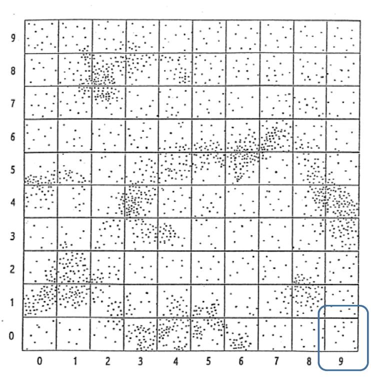
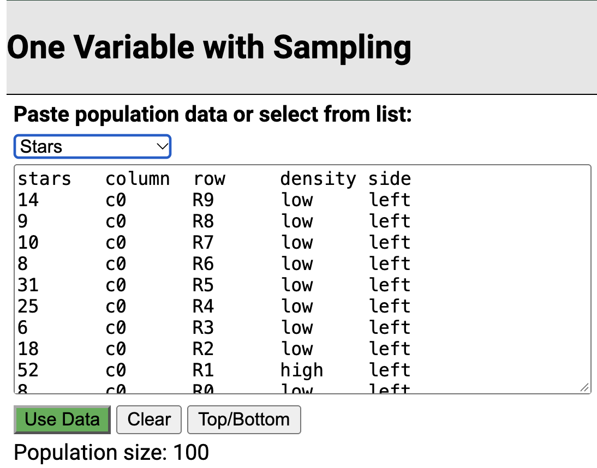
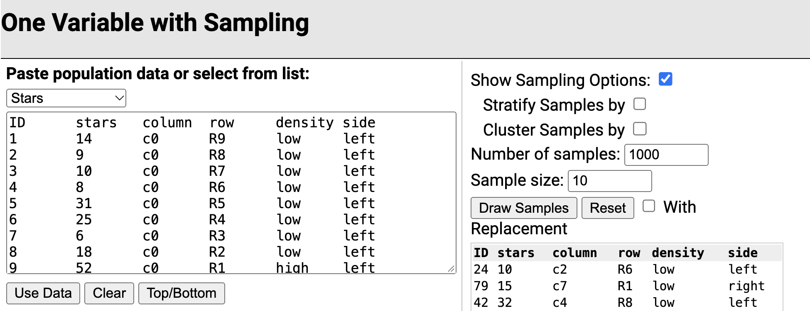
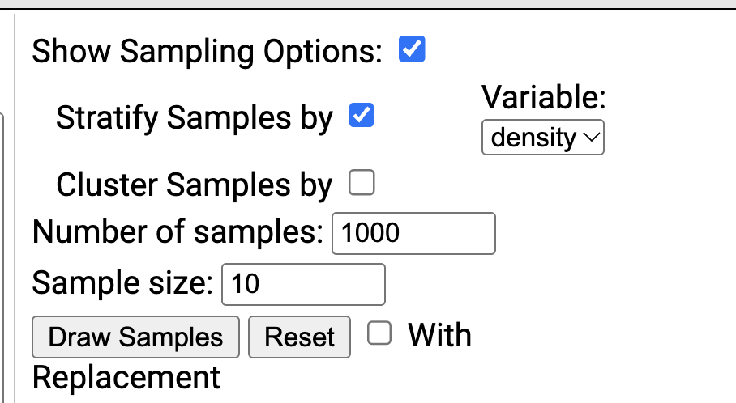
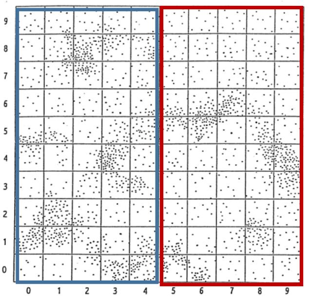

::: callout-warning
- Submit via Gradescope, don't forget to assign pages to the questions in the outline!

- Delete any extraneous instructions (**like this box**) before submission. *You will be deducted points from now on if you do not follow this instruction!*

- You do not need to do any R coding for this activity, I would recommend that you use the Word template.
- But you are welcome to use the quarto template as always!  [10.2-activity-stars.qmd](../student/10.2-activity-stars.qmd)
  
:::

## Counting the Stars in the Sky

Have you ever wondered how many visible stars there are when looking at the night sky?

1. What approach would you take to estimate the number of stars in the sky? Think about: Is it feasible to just count all of them? What are some challenges you could imagine to getting this count?

## Study

Here is one approach to answering some form of our original question.

Assume we have a photograph of part of the night sky taken from Bishop's peak on October 31, 2026 at 10:30pm.

Note that the question we can really only feasible try to answer is: 

>How many **visible** stars are there in **this section** of the night sky on **October 26th, 2026 at 10:30pm**, from **San Luis Obispo, CA**?

The negative for the photograph was used, so the stars appear as black dots and the background sky is white

We will identify each square by a two‐digit number consisting of the number on the horizontal axis (0‐9) followed by the number on the vertical axis (0‐9), as shown below:

{width=40%}

2. This **map** with the grid (aka 100 squares) will be our **sampling frame**! What do you think our **sampling unit** and **observational** unit should be to estimate the number of stars in the picture.

3. We will take a SRS of 10 **squares** out of the 100 total squares. Define/describe the elements of our sample:

- target population, $N=?$:

- sampling frame: *100 squares*

- sample, $n=?$:

- sampled population:

- sampling unit:

- observation unit:

- variable (what we *record* for each unit): 

4. Let $y_i$ be the number of stars in square $i$. If we are interested in the number of stars in this section of the sky, what population parameter should we try to estimate? (give the notation and name).

## Estimating Stars with SRS

:::callout-tip
## Working with Population Data

For this activity, we will use the [Rossman Chance simulation applet](https://www.rossmanchance.com/applets/2021/sampling/OneSample.html?population=stars). Hopefully you are familiar from other courses!

The applet has the **population data** *Stars* for the number of stars in the full map. Remember we normally don't get to see a whole population or we wouldn't need to do sampling and estimation... but we do have access to this population as a learning tool!
:::

:::callout-warning

### Follow the instructions to set up the applet for this activity:

a. Use the link above or here to open the [**One Variable with Sampling**](https://www.rossmanchance.com/applets/2021/sampling/OneSample.html?population=stars) applet. PLEASE DONT JUST GOOGLE THE APPLET - you might end up on an old version.
b. Use the dropdown to select the **Stars** data instead of the Sleep 1 data. It should look like the screenshot below.
{width=50%}
c. Select the green **Use Data** button as shown in the screenshot

:::

5. What are the values of the population parameters $\mu$, $\tau$ and $\sigma^2$?

6. How would you describe the distribution of star counts among the 100 squares?

### Mean

Let's start with estimating the population mean number of stars in a square $\mu$.

7. What is the expected value and true variance of the sample mean $\bar{y}$?

:::callout-warning

### More App instructions

{width=70%}

d. Select "Show Sampling Options" to the right
e. Enter (at least) 1000 for the **Number of samples**
f. We want to sample $n = 10$ squares, so you don't have to change **Sample size**
g. Click **Draw Samples**

:::

8. Include a screenshot of the last set of **sample data**, making sure the Mean and SD values are visible.

9. What would you have *estimated* the mean number of stars per square was based on that latest sample? What would you have *estimated* the sampling variance was? Don't forget to use the fpc!

10. Include a screenshot of the **sampling distribution** of the sample mean making sure the mean and SD values are visible.

11. Did the simulated distribution align with your calculations of $\mathbb{E}[\bar{y}]$ and $\mathbb{V}[\bar{y}]$ in Q7?

### Total

Now let's get to the question we were really interested in!  To estimate the the population total number of stars across the full picture $\tau$.

You don't need to change the applet at all!

12. What is the expected value and true variance of the total estimate $\hat{\tau}$ for SRS?

13. What would you have *estimated* the total number of stars per square was based on that latest sample? What would you have *estimated* the sampling variance of the total estimate was? Don't forget to use the fpc!

14. Did the simulated distribution align with your calculations of $\mathbb{E}[\hat{\tau}]$ and $\mathbb{V}[\hat{\tau}]$ in Q12?

15. Was this sampling method and estimation **unbiased**, **precise**, and/or **accurate**? Explain.

## Estimating Stars with Stratified Random Sampling

16. What is a potential benefit to using stratified random sampling to estimate the number of stars?

You could stratify by any number of things! We are going to look into two possibilities.

### Stratify by Density

Divide the star map into two strata, high density and low density.

- Low density: $N_1 = 80$ squares
- High density: $N_2 = 20$ squares

17. Let $g = 1$ index the low density stratum and $g = 2$ index the high density stratum. Say I will be taking a sample proportional to the population sizes of the stratum. 

Define the following in context

- $\mu_1:$
- $\sigma^2_1:$
- $\bar{y}_1:$
- $s^2_1:$

Fill in the values:

- $L =$
- $N =$
- $n = 10$
- $n_1 =$
- $n_2 =$

:::callout-warning

### More App instructions

h. Go back to the applet and select **Stratify Samples by** under "Show Sampling Options"
i. Choose *density* under **Variable:**
j. Take 1,000 samples of size 10

{width=50%}

:::

18. Include a screenshot of the last set of **sample data**, making sure the Mean and SD values are visible.

19. Include a screenshot of the **sampling distribution** of the sample mean making sure the mean and SD values are visible.

20. Did the simulated distribution align with your expectations?

21. How did doing stratified sampling based on *density* compare to SRS in terms of bias, precision, and accuracy?

### Stratify by Side

What if we consider side of the map instead?

Let's split the star map vertically into two equal halves

- stars in the left 50 squares of the map (columns 0 – 4) would be in the **left stratum**
- stars in the right 50 squares of the
map (columns 5 – 9) would be in
the **right stratum**.

{width=30%}

:::callout-warning
### Back to the app!

k. Now, stratify by the *side* variable rather than *density*
l. Run 1,000 simulations with this stratification

:::

22. Include a screenshot of the last set of **sample data**, making sure the Mean and SD values are visible.

23. Include a screenshot of the **sampling distribution** of the sample mean making sure the mean and SD values are visible.

24. How did doing stratified sampling based on *side* compare to SRS in terms of bias, precision, and accuracy?
